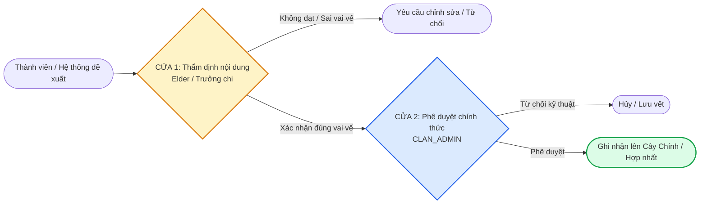
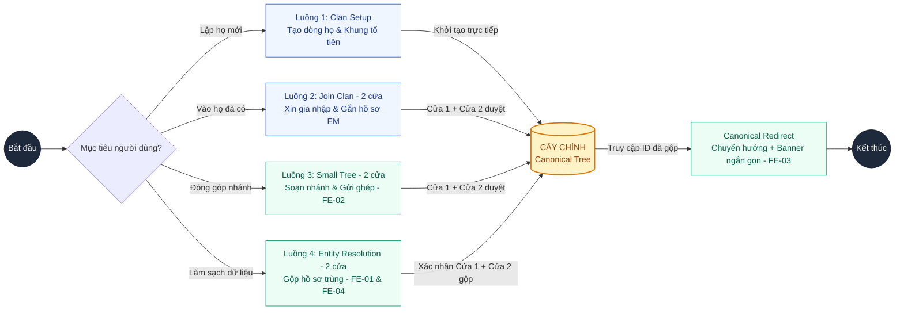
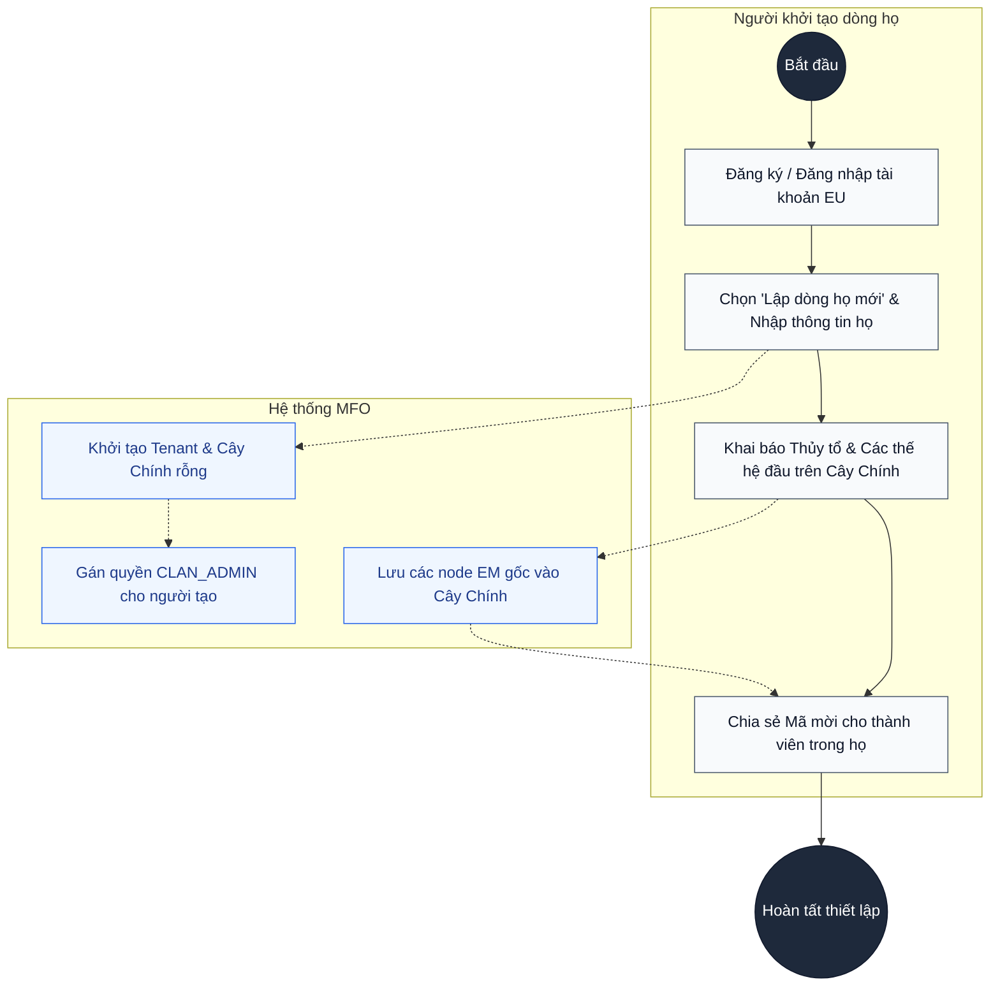
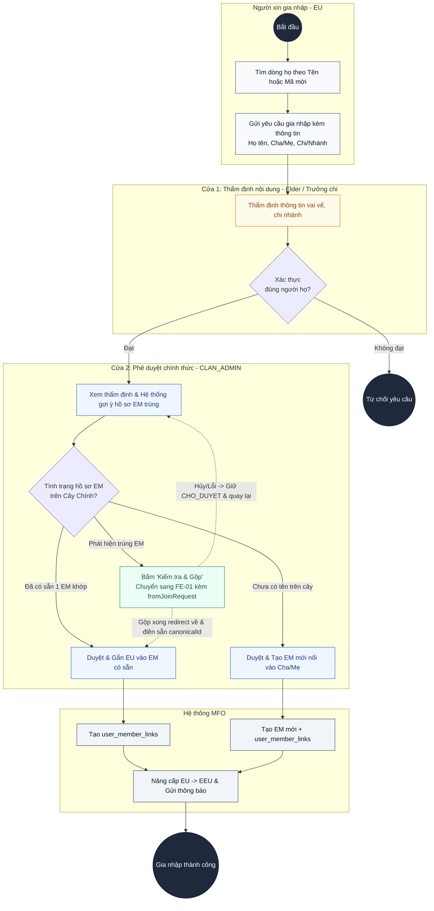
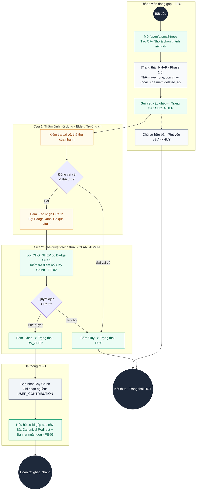
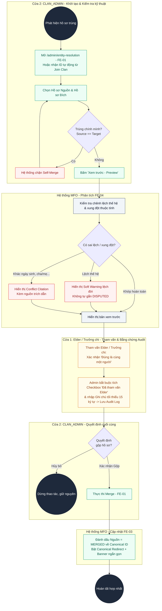
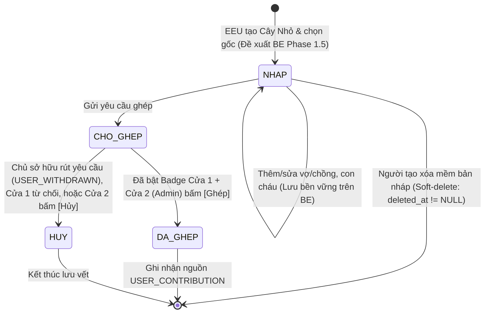
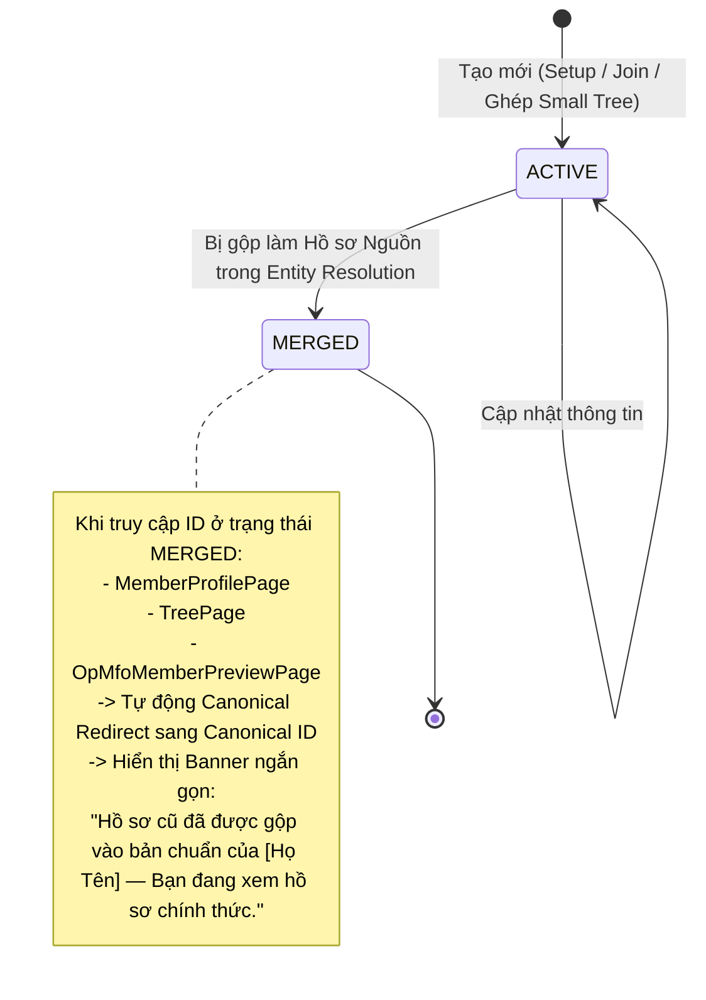

# Quy trình chung MFO (My Family Organization) — Phiên bản 1.4 (Final Baseline)

**Ngày cập nhật:** 2026-11-26  
**Trạng thái tài liệu:** Baseline chuẩn cho Nghiệp vụ (BA/Stakeholder) & Kỹ thuật (FE/BE/QA)  
**Mục đích:** Kết nối các khối kỹ thuật Phase 1 (`FE-01` đến `FE-04`) vào dòng chảy nghiệp vụ thống nhất, chuẩn hóa thuật ngữ domain (`EU`, `EEU`, `EM`), chốt các quy tắc kiểm soát **quy trình 2 cửa** cùng các hành vi xử lý ngoại lệ (edge cases), và lưu trữ mã sơ đồ trực quan phục vụ toàn đội dự án.

**Ký hiệu quy ước trong sơ đồ (Chuẩn hóa BPMN trên Mermaid):**
* `([ ])` / `(( ))` : **Start / End Event** (Điểm bắt đầu / kết thúc luồng)
* `[ ]` : **Task / Activity** (Hành động của người dùng hoặc hệ thống)
* `{ }` : **Gateway** (Điểm rẽ nhánh quyết định / điều kiện)
* `Subgraph (Swimlane)` : Phân tách trách nhiệm theo **Vai trò (Actor) & Cửa kiểm soát**

---

## 0. Thuật ngữ và tên tắt

| Thuật ngữ / Tên tắt | Ý nghĩa & Ngữ cảnh sử dụng |
| :--- | :--- |
| **MFO** | My Family Organization — phân hệ quản lý dòng họ / gia phả trên hệ thống |
| **Tenant** | Không gian dữ liệu độc lập của một dòng họ trên hệ thống |
| **Cây Chính (Canonical Tree)** | Dữ liệu phả đồ chính thức duy nhất của một dòng họ |
| **Cây Nhỏ (Small Tree)** | Không gian làm việc riêng để thành viên đóng góp một nhánh trước khi được ghép vào Cây Chính |
| **EU** | End User — Người dùng cuối hoặc người truy cập vào hệ thống (chưa nhất thiết thuộc dòng họ) |
| **EEU** | Existing End User — Người dùng cuối đã tồn tại tài khoản và được liên kết trong hệ thống dòng họ |
| **EM** | Existing Member — Hồ sơ thành viên đã có trong sổ họ / trên Cây Chính |
| **Elder** | Người cao tuổi / Bô lão trong họ (`ELDER`), có uy tín và am hiểu lịch sử dòng họ |
| **Trưởng chi / phái / nhánh** | Người có vai vế đứng đầu một nhánh trong họ (`BRANCH_HEAD`), nắm rõ thế thứ (thường đảm nhận Cửa 1) |
| **CLAN_ADMIN** | Quản trị viên dòng họ — người chịu trách nhiệm kỹ thuật và phê duyệt chính thức ở **Cửa 2** |
| **Cửa 1 (Thẩm định nội dung)** | Bước kiểm tra tính xác thực về vai vế, thế thứ, nguồn gốc bởi **Elder / Trưởng chi** |
| **Cửa 2 (Phê duyệt chính thức)** | Bước ra quyết định cuối cùng ghi nhận dữ liệu lên Cây Chính hoặc thực hiện gộp bởi **CLAN_ADMIN** |
| **Entity Resolution** | Quá trình xác định và gộp các hồ sơ `EM` bị trùng thành một hồ sơ chuẩn |
| **Canonical ID / Hồ sơ chuẩn** | Hồ sơ `EM` còn lại sau khi gộp, được coi là bản chính thức duy nhất |
| **Canonical Redirect** | Cơ chế tự động chuyển hướng khi người dùng truy cập vào hồ sơ đã bị gộp |
| **Soft Warning** | Cảnh báo mềm (ví dụ lệch thế hệ) giúp con người lưu ý mà không tự động gắn trạng thái tranh chấp |
| **Conflict Citation** | Bản ghi đánh dấu có mâu thuẫn thông tin khi gộp, kèm nguồn trích dẫn để đối chiếu |
| **NHAP** *(Phase 1.5)* | Trạng thái Cây Nhỏ đang được thành viên soạn thảo trên hệ thống trước khi gửi duyệt |
| **CHO_GHEP** | Trạng thái Cây Nhỏ đã gửi và đang chờ duyệt ghép vào Cây Chính |
| **DA_GHEP** | Trạng thái Cây Nhỏ đã được phê duyệt và ghép vào Cây Chính |
| **HUY** | Trạng thái Cây Nhỏ bị hủy (do Admin từ chối ở Cửa 1/Cửa 2 hoặc người tạo rút lại khi đang `CHO_GHEP`) |
| **USER_CONTRIBUTION** | Nguồn dữ liệu được tạo khi ghép Cây Nhỏ vào Cây Chính |

---

## 1. Nguyên tắc vận hành & Mô hình 2 cửa

### 1.1 Ba nguyên tắc dữ liệu cốt lõi
1. **Một Phả Đồ Chính — Nhiều Nguồn Đóng Góp:**  
   Cây Chính là dữ liệu chính thức duy nhất. Cây Nhỏ là không gian làm việc riêng trước khi được ghép và gắn nguồn `USER_CONTRIBUTION`.
2. **Hợp nhất không mất dấu & Thông báo ngắn gọn:**  
   Khi gộp hồ sơ (`Entity Resolution`), hồ sơ cũ không bị xóa vật lý mà chuyển sang trạng thái đã gộp (`MERGED`). Mọi truy cập bằng ID cũ được tự động chuyển hướng sang hồ sơ chuẩn (`Canonical ID`) kèm banner ngắn gọn, dễ hiểu cho người cao tuổi (`EEU`):
   > *"Hồ sơ cũ đã được gộp vào bản chuẩn của **[Họ Tên]** — Bạn đang xem hồ sơ chính thức."*
3. **Cảnh báo thông minh, con người quyết định:**  
   Hệ thống cảnh báo lệch đời (`Soft Warning`) hoặc xung đột thông tin (`Conflict Citation`) nhưng **không tự gắn trạng thái tranh chấp**. Người có thẩm quyền đối chiếu thực tế và tự quyết định.

### 1.2 Quy trình 2 cửa (Two-Gate Governance)
Các bước cần phê duyệt đều đi qua hai cửa kiểm soát nhằm đảm bảo vừa chuẩn xác về **gia phong/thế thứ**, vừa toàn vẹn về **dữ liệu kỹ thuật**:



* **Cửa 1 — Thẩm định nội dung:** Trưởng chi / phái / nhánh (`BRANCH_HEAD`) hoặc Elder được ủy quyền (`ELDER`) xác minh vai vế, thế thứ, nguồn gốc.
* **Cửa 2 — Phê duyệt chính thức:** `CLAN_ADMIN` kiểm tra tính hợp lệ dữ liệu trên hệ thống và quyết định ghi nhận vào Cây Chính hoặc thực hiện gộp.

### 1.3 Phân định vai trò tham gia

| Vai trò | Mã / Nhóm | Trách nhiệm chính |
| :--- | :--- | :--- |
| **Người xin gia nhập** | `EU` | Tìm dòng họ theo tên/mã mời, gửi yêu cầu xác nhận thành viên. |
| **Thành viên đóng góp** | `EEU` | Người dùng cuối đã tồn tại trong họ, xem cây, tạo Cây Nhỏ (`Small Tree`) và có quyền rút yêu cầu khi đang `CHO_GHEP`. |
| **Elder** | `ELDER` | Người cao tuổi trong họ, tham gia thẩm định nội dung ở Cửa 1. |
| **Trưởng chi / phái / nhánh** | `BRANCH_HEAD` | Người có vai vế trong họ, thường đảm nhận **Cửa 1** (bấm xác nhận thẩm định trên UI). |
| **Quản trị viên dòng họ** | `CLAN_ADMIN` | Phê duyệt chính thức (**Cửa 2**), duyệt ghép Cây Nhỏ, thực hiện gộp hồ sơ trùng. |

---

## 2. Sơ đồ Tổng quan Hệ sinh thái MFO (End-to-End Landscape)

| Luồng | Mục tiêu | Áp dụng 2 cửa? | Khối Phase 1 liên quan |
| :--- | :--- | :--- | :--- |
| **1. Clan Setup** | Lập dòng họ mới, dựng Cây Chính ban đầu | Không (người tạo trở thành Admin) | Core |
| **2. Join Clan** | Xin vào dòng họ đã có, gắn `EU` với `EM` | **Có** | Core + `FE-01` (nếu trùng) |
| **3. Small Tree Contribution** | Đóng góp nhánh phả đồ mới vào Cây Chính | **Có** | `FE-02`, `FE-03` |
| **4. Entity Resolution** | Gộp các hồ sơ `EM` bị trùng lặp | **Có** (Bắt buộc checkbox + ghi chú Cửa 1) | `FE-01`, `FE-03`, `FE-04` |



---

## 3. Chi tiết 4 Luồng Nghiệp Vụ (Sơ đồ BPMN theo Swimlane)

### 3.1 Luồng 1: Khởi tạo Dòng họ (`Clan Setup`)
* **Bối cảnh:** Dòng họ chưa tồn tại trên hệ thống. Không dùng Small Tree ở giai đoạn này vì Cây Chính đang rỗng.



---

### 3.2 Luồng 2: Gia nhập Dòng họ (`Join Clan` — Quy trình 2 cửa)
* **Bối cảnh:** Thành viên (`EU`) muốn tham gia dòng họ đã có trên hệ thống và liên kết tài khoản với hồ sơ `EM`.
* **Quy tắc chuyển tiếp & quay lại với Entity Resolution (`FE-01`):**
  1. **Kích hoạt:** Hệ thống tự đối chiếu sơ bộ (trùng họ tên + năm sinh/tên cha) và gợi ý *"Có hồ sơ EM nghi trùng"* trên màn hình chi tiết yêu cầu gia nhập (`/admin/join-requests/:requestId`). `CLAN_ADMIN` chủ động bấm **"Kiểm tra & Gộp hồ sơ trùng"** để điều hướng sang `/admin/entity-resolution?sourceId={draftOrNewEmId}&targetId={existingEmId}&fromJoinRequest={requestId}`.
  2. **Khi gộp thành công:** Wizard tự động `navigate` quay lại `/admin/join-requests/:requestId?mergedTargetId={canonicalId}`, tự động điền sẵn `canonicalId` để Admin bấm hoàn tất gắn `user_member_links`.
  3. **Khi Admin hủy giữa chừng hoặc gộp thất bại:** Không thay đổi dữ liệu 2 hồ sơ `EM`; yêu cầu gia nhập vẫn giữ nguyên trạng thái **`CHO_DUYET`**. Nút **"Quay lại yêu cầu gia nhập"** đưa Admin về `/admin/join-requests/:requestId` để xử lý lại.



---

### 3.3 Luồng 3: Đóng góp Nhánh Phả đồ (`Small Tree Contribution` — Quy trình 2 cửa)
* **Gắn kết kỹ thuật:** `FE-02` (Quản lý Small Trees), `FE-03` (Canonical Redirect).
* **Quy định hành vi cụ thể:**
  1. **Xóa nháp (`NHAP` — Phase 1.5):** Là **xóa mềm (`soft-delete`)** bằng cách cập nhật `deleted_at = NOW()` và `deleted_by = user_id` (không xóa vật lý khỏi DB). Bản nháp đã xóa mềm bị ẩn khỏi UI nhưng vẫn giữ dấu vết audit.
  2. **Rút yêu cầu (`CHO_GHEP` $\rightarrow$ `HUY`):** Chủ sở hữu Cây Nhỏ được phép bấm **"Rút yêu cầu"** khi trạng thái đang là `CHO_GHEP` (chưa duyệt ghép), chuyển sang `HUY` với lý do `USER_WITHDRAWN` (cần mở quyền owner cho endpoint `POST /small-trees/:id/cancel` trên BE).
  3. **Bật Badge "Đã qua Cửa 1":** Tài khoản `ELDER` hoặc `BRANCH_HEAD` (hoặc `CLAN_ADMIN` thao tác thay kèm ghi chú xác nhận) bấm nút **"Xác nhận thẩm định nội dung (Cửa 1)"** trên màn hình chi tiết Cây Nhỏ để bật badge xanh **`Đã qua Cửa 1`** (`gate1_verified_by`, `gate1_verified_at`), từ đó mở khóa nút **"Ghép"** cho Cửa 2.



---

### 3.4 Luồng 4: Rà soát & Hợp nhất Hồ sơ trùng (`Entity Resolution` — Quy trình 2 cửa)
* **Gắn kết kỹ thuật:** `FE-01` (Entity Resolution Wizard), `FE-04` (`GenerationOffsetWarning`, `ConflictCitationList`), `FE-03` (Canonical Redirect).
* **Quy định kiểm soát Cửa 1 & Trách nhiệm:**
  * Để mở khóa nút **Thực thi Merge** ở Cửa 2, Wizard bắt buộc đồng thời:
    1. Tích chọn checkbox: *"Tôi xác nhận đã tham vấn Elder / Trưởng chi và hai hồ sơ này là cùng một người"*.
    2. Nhập **Ghi chú đối chứng bắt buộc** (tối thiểu 15 ký tự, ví dụ: *"Bác Trưởng chi 2 xác nhận qua điện thoại ngày 26/11"*).
  * Checkbox + ghi chú này được lưu bất biến vào `audit_log` làm bằng chứng hệ thống; `CLAN_ADMIN` chịu trách nhiệm giải trình trước dòng họ về tính xác thực của nội dung đã khai báo.



---

## 4. Sơ đồ Vòng đời Trạng thái (State Machines cho Dev & QA)

### 4.1 Vòng đời Cây Nhỏ (`Small Tree` — `FE-02`)


### 4.2 Vòng đời Hồ sơ Thành viên (`EM` & `Canonical Redirect` — `FE-01`, `FE-03`)


---

## 5. Ma trận truy vết Kỹ thuật (Traceability Matrix)

| Bước nghiệp vụ | Vai trò | Màn hình / Route | Khối Phase 1 | Việc nghiệp vụ đã chốt | Việc kỹ thuật (UI/BE) cần làm |
| :--- | :--- | :--- | :--- | :--- | :--- |
| **1. Tạo dòng họ mới** | Người lập họ (`CLAN_ADMIN`) | Trang khởi tạo Clan | Core | Không qua 2 cửa. Nhập trực tiếp vào Cây Chính. | Đã hoàn thiện ở Core. |
| **2. Xin gia nhập & xử lý trùng** | `EU` $\rightarrow$ Elder $\rightarrow$ Admin | `/admin/join-requests/:requestId` | Core + `FE-01` | Chuyển sang `FE-01` kèm `fromJoinRequest`; gộp xong quay lại điền sẵn `canonicalId`; hủy/lỗi giữ nguyên `CHO_DUYET`. | Truyền query params `sourceId`, `targetId`, `fromJoinRequest`; xử lý callback redirect về `/admin/join-requests/:requestId`. |
| **3. Tạo, soạn & rút Cây Nhỏ** | `EEU` | `/op/mfo/small-trees` | `FE-02` | Xóa ở `NHAP` là **xóa mềm (`deleted_at`)**; cho phép chủ sở hữu rút yêu cầu khi đang `CHO_GHEP` (`HUY`). | Bổ sung trạng thái `NHAP` (soft-delete) & UI thêm/sửa con cháu; mở quyền owner cho endpoint `cancel` khi `CHO_GHEP`. |
| **4. Thẩm định & duyệt Cây Nhỏ** | Elder/Trưởng chi (Cửa 1) $\rightarrow$ Admin (Cửa 2) | `/op/mfo/small-trees` | `FE-02` | Tài khoản `ELDER`/`BRANCH_HEAD` (hoặc Admin thao tác thay có ghi chú) bấm xác nhận để bật badge **`Đã qua Cửa 1`**. | Hoàn tất fix `extractItems(raw)` ở `SmallTreesList.jsx`; thêm nút xác nhận Cửa 1 & badge trạng thái trên danh sách. |
| **5. Preview & gộp hồ sơ** | Elder (Cửa 1) $\rightarrow$ Admin (Cửa 2) | `/admin/entity-resolution` | `FE-01`, `FE-04` | Bắt buộc tích checkbox *"Đã tham vấn Elder"* + nhập **ghi chú tối thiểu 15 ký tự** lưu `audit_log` (Admin chịu trách nhiệm). | Thêm checkbox + validation ghi chú $\ge 15$ ký tự để mở khóa nút Merge; lưu vào `audit_log`. |
| **6. Truy cập hồ sơ đã gộp** | Mọi người (`EU` / `EEU`) | `MemberProfilePage`, `TreePage`, `OpMfoMemberPreviewPage` | `FE-03` | Dùng thông báo 1 dòng ngắn gọn, dễ hiểu cho người cao tuổi (`EEU`). | Cập nhật Banner hiển thị: *"Hồ sơ cũ đã được gộp vào bản chuẩn của [Họ Tên] — Bạn đang xem hồ sơ chính thức."* |

---

## 6. Phụ lục: Mã XML nhập trực tiếp vào diagrams.net (Draw.io)

Để vẽ sơ đồ **Swimlane ngang 4 làn chuẩn BPMN 2.0** trên [app.diagrams.net](https://app.diagrams.net/) mà không cần tự căn chỉnh vị trí:
1. Mở **diagrams.net** $\rightarrow$ Chọn menu **Extras** $\rightarrow$ **Edit Diagram...** (hoặc **Arrange** $\rightarrow$ **Insert** $\rightarrow$ **Advanced** $\rightarrow$ **From Text...**).
2. Dán đoạn mã XML dưới đây và nhấn **OK**:

```xml
<mxGraphModel dx="1200" dy="800" grid="1" gridSize="10" guides="1" tooltips="1" connect="1" arrows="1" fold="1" page="1" pageScale="1" pageWidth="1169" pageHeight="827" math="0" shadow="0">
  <root>
    <mxCell id="0" />
    <mxCell id="1" parent="0" />
    <mxCell id="pool" value="QUY TRÌNH ĐÓNG GÓP NHÁNH PHẢ ĐỒ (SMALL TREE CONTRIBUTION — MÔ HÌNH 2 CỬA)" style="swimlane;childLayout=stackLayout;resizeParent=1;resizeParentMax=0;horizontal=0;startSize=36;horizontalStack=0;fillColor=#f8fafc;strokeColor=#475569;fontStyle=1;fontSize=14;" vertex="1" parent="1">
      <mxGeometry x="30" y="30" width="1100" height="640" as="geometry" />
    </mxCell>
    <mxCell id="lane_eeu" value="1. Thành viên đóng góp&#xa;(EEU)" style="swimlane;startSize=140;horizontal=0;fillColor=#ffffff;strokeColor=#94a3b8;fontStyle=1;fontSize=12;" vertex="1" parent="pool">
      <mxGeometry x="36" y="0" width="1064" height="160" as="geometry" />
    </mxCell>
    <mxCell id="start" value="Bắt đầu" style="ellipse;whiteSpace=wrap;html=1;aspect=fixed;fillColor=#dcfce7;strokeColor=#16a34a;strokeWidth=2;fontStyle=1;" vertex="1" parent="lane_eeu">
      <mxGeometry x="170" y="50" width="60" height="60" as="geometry" />
    </mxCell>
    <mxCell id="eeu_1" value="Tạo Cây Nhỏ&#xa;&amp; chọn điểm gốc" style="rounded=1;whiteSpace=wrap;html=1;fillColor=#f1f5f9;strokeColor=#475569;fontSize=12;" vertex="1" parent="lane_eeu">
      <mxGeometry x="270" y="50" width="140" height="60" as="geometry" />
    </mxCell>
    <mxCell id="eeu_2" value="Soạn thảo [NHAP]:&#xa;Thêm con cháu / Xóa mềm" style="rounded=1;whiteSpace=wrap;html=1;fillColor=#f1f5f9;strokeColor=#475569;fontSize=12;" vertex="1" parent="lane_eeu">
      <mxGeometry x="450" y="50" width="150" height="60" as="geometry" />
    </mxCell>
    <mxCell id="eeu_3" value="Gửi yêu cầu ghép&#xa;(Trạng thái: CHO_GHEP)" style="rounded=1;whiteSpace=wrap;html=1;fillColor=#e0f2fe;strokeColor=#0284c7;fontStyle=1;fontSize=12;" vertex="1" parent="lane_eeu">
      <mxGeometry x="640" y="50" width="160" height="60" as="geometry" />
    </mxCell>
    <mxCell id="lane_g1" value="2. CỬA 1: Thẩm định&#xa;(Elder / Trưởng chi)" style="swimlane;startSize=140;horizontal=0;fillColor=#fffbeb;strokeColor=#f59e0b;fontStyle=1;fontSize=12;" vertex="1" parent="pool">
      <mxGeometry x="36" y="160" width="1064" height="160" as="geometry" />
    </mxCell>
    <mxCell id="g1_task" value="Thẩm định vai vế&#xa;&amp; Bật Badge Cửa 1" style="rounded=1;whiteSpace=wrap;html=1;fillColor=#fef3c7;strokeColor=#d97706;fontSize=12;" vertex="1" parent="lane_g1">
      <mxGeometry x="450" y="50" width="150" height="60" as="geometry" />
    </mxCell>
    <mxCell id="g1_dec" value="Đúng&#xa;vai vế?" style="rhombus;whiteSpace=wrap;html=1;fillColor=#fde68a;strokeColor=#b45309;fontStyle=1;fontSize=12;" vertex="1" parent="lane_g1">
      <mxGeometry x="675" y="35" width="90" height="90" as="geometry" />
    </mxCell>
    <mxCell id="lane_g2" value="3. CỬA 2: Phê duyệt&#xa;(CLAN_ADMIN)" style="swimlane;startSize=140;horizontal=0;fillColor=#eff6ff;strokeColor=#3b82f6;fontStyle=1;fontSize=12;" vertex="1" parent="pool">
      <mxGeometry x="36" y="320" width="1064" height="170" as="geometry" />
    </mxCell>
    <mxCell id="g2_task" value="Kiểm tra điểm nối&#xa;(Khi có Badge Cửa 1)" style="rounded=1;whiteSpace=wrap;html=1;fillColor=#dbeafe;strokeColor=#2563eb;fontSize=12;" vertex="1" parent="lane_g2">
      <mxGeometry x="450" y="55" width="150" height="60" as="geometry" />
    </mxCell>
    <mxCell id="g2_dec" value="Duyệt&#xa;ghép?" style="rhombus;whiteSpace=wrap;html=1;fillColor=#bfdbfe;strokeColor=#1d4ed8;fontStyle=1;fontSize=12;" vertex="1" parent="lane_g2">
      <mxGeometry x="675" y="40" width="90" height="90" as="geometry" />
    </mxCell>
    <mxCell id="g2_reject" value="Từ chối / Bấm Hủy&#xa;(Trạng thái: HUY)" style="rounded=1;whiteSpace=wrap;html=1;fillColor=#fee2e2;strokeColor=#dc2626;fontStyle=1;fontSize=12;" vertex="1" parent="lane_g2">
      <mxGeometry x="860" y="15" width="160" height="50" as="geometry" />
    </mxCell>
    <mxCell id="g2_approve" value="Bấm Ghép&#xa;(Trạng thái: DA_GHEP)" style="rounded=1;whiteSpace=wrap;html=1;fillColor=#dcfce7;strokeColor=#16a34a;fontStyle=1;fontSize=12;" vertex="1" parent="lane_g2">
      <mxGeometry x="860" y="100" width="160" height="50" as="geometry" />
    </mxCell>
    <mxCell id="lane_sys" value="4. Hệ thống MFO&#xa;(Backend / UI)" style="swimlane;startSize=140;horizontal=0;fillColor=#f8fafc;strokeColor=#94a3b8;fontStyle=1;fontSize=12;" vertex="1" parent="pool">
      <mxGeometry x="36" y="490" width="1064" height="150" as="geometry" />
    </mxCell>
    <mxCell id="sys_merge" value="Hợp nhất vào Cây Chính&#xa;&amp; gắn nguồn USER_CONTRIBUTION" style="rounded=1;whiteSpace=wrap;html=1;fillColor=#e2e8f0;strokeColor=#334155;fontSize=12;" vertex="1" parent="lane_sys">
      <mxGeometry x="620" y="45" width="200" height="60" as="geometry" />
    </mxCell>
    <mxCell id="end" value="Hoàn tất" style="ellipse;whiteSpace=wrap;html=1;aspect=fixed;fillColor=#fee2e2;strokeColor=#dc2626;strokeWidth=3;fontStyle=1;" vertex="1" parent="lane_sys">
      <mxGeometry x="910" y="45" width="60" height="60" as="geometry" />
    </mxCell>
    <mxCell id="e1" edge="1" parent="lane_eeu" source="start" target="eeu_1"><mxGeometry relative="1" as="geometry" /></mxCell>
    <mxCell id="e2" edge="1" parent="lane_eeu" source="eeu_1" target="eeu_2"><mxGeometry relative="1" as="geometry" /></mxCell>
    <mxCell id="e3" edge="1" parent="lane_eeu" source="eeu_2" target="eeu_3"><mxGeometry relative="1" as="geometry" /></mxCell>
    <mxCell id="e4" style="edgeStyle=orthogonalEdgeStyle;" edge="1" parent="pool" source="eeu_3" target="g1_task"><mxGeometry relative="1" as="geometry" /></mxCell>
    <mxCell id="e5" edge="1" parent="lane_g1" source="g1_task" target="g1_dec"><mxGeometry relative="1" as="geometry" /></mxCell>
    <mxCell id="e6" value="Không" style="edgeStyle=orthogonalEdgeStyle;fontColor=#dc2626;fontStyle=1;" edge="1" parent="pool" source="g1_dec" target="g2_reject"><mxGeometry relative="1" as="geometry" /></mxCell>
    <mxCell id="e7" value="Đạt" style="edgeStyle=orthogonalEdgeStyle;fontColor=#16a34a;fontStyle=1;" edge="1" parent="pool" source="g1_dec" target="g2_task"><mxGeometry relative="1" as="geometry" /></mxCell>
    <mxCell id="e8" edge="1" parent="lane_g2" source="g2_task" target="g2_dec"><mxGeometry relative="1" as="geometry" /></mxCell>
    <mxCell id="e9" value="Từ chối" style="edgeStyle=orthogonalEdgeStyle;fontColor=#dc2626;fontStyle=1;" edge="1" parent="lane_g2" source="g2_dec" target="g2_reject"><mxGeometry relative="1" as="geometry" /></mxCell>
    <mxCell id="e10" value="Đồng ý" style="edgeStyle=orthogonalEdgeStyle;fontColor=#16a34a;fontStyle=1;" edge="1" parent="lane_g2" source="g2_dec" target="g2_approve"><mxGeometry relative="1" as="geometry" /></mxCell>
    <mxCell id="e11" style="edgeStyle=orthogonalEdgeStyle;" edge="1" parent="pool" source="g2_approve" target="sys_merge"><mxGeometry relative="1" as="geometry" /></mxCell>
    <mxCell id="e12" edge="1" parent="lane_sys" source="sys_merge" target="end"><mxGeometry relative="1" as="geometry" /></mxCell>
  </root>
</mxGraphModel>
```

---

## 7. Kế hoạch triển khai tiếp theo

1. **Đóng gói nghiệm thu Phase 1 hiện tại (`FE-01` đến `FE-04`):** Hoàn tất fix `extractItems(raw)` trong `SmallTreesList.jsx` và chạy pass toàn bộ checklist kiểm thử trên staging.
2. **Triển khai Phase 1.5 (Hoàn thiện vòng đời Small Tree & Dấu vết 2 cửa):**
   * Bổ sung trạng thái `NHAP` (hỗ trợ `soft-delete` qua `deleted_at`), mở quyền chủ sở hữu rút yêu cầu ở `CHO_GHEP` (`USER_WITHDRAWN`), và xây dựng UI thêm/sửa thành viên con trong Cây Nhỏ.
   * Bổ sung nút xác nhận Cửa 1 (bật badge **`Đã qua Cửa 1`**) cho vai trò `ELDER`/`BRANCH_HEAD` trên màn hình Small Trees.
   * Bổ sung checkbox *"Đã tham vấn Elder"* + ô ghi chú bắt buộc $\ge 15$ ký tự lưu `audit_log` ở bước cuối Wizard `FE-01`, cùng luồng điều hướng hai chiều với `Join Clan`.
   * Cập nhật thông báo Banner `Canonical Redirect` (`FE-03`) theo mẫu câu ngắn gọn 1 dòng.