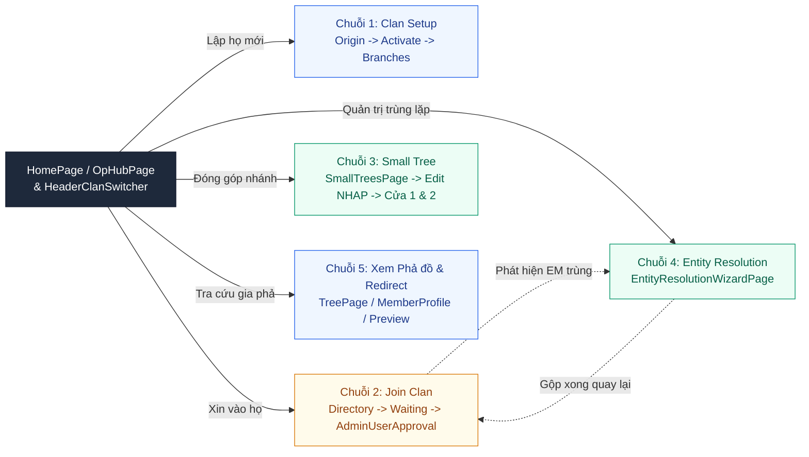

# Thiết kế Chuỗi Màn hình MFO (UI Flow & Screen Specification) — Phiên bản 2.0 (Final Frozen)

**Ngày đóng băng (Freeze Date):** 2026-11-26 
**Phiên bản:** 2.0 
**Trạng thái tài liệu:** **FINAL FROZEN** — Bản chuẩn chính thức cho Thiết kế (UI/UX), Frontend (`gia-pha-frontend`), Backend & QA  
**Căn cứ SSOT:** 
  (1) Mã nguồn thực tế từ `fe-ssot-bundle.zip` (`src/App.jsx`, `src/pages/*`, `src/features/mfo/*`).
  (2) PLAN-MFO-2026-IMPLEMENTATION - Tài liệu kế hoạch triển khai BE.
  (3) PLAN-MFO-2026-IMPLEMENTATION-BPMN - Tài liệu Quy trình MFO.  
**Mục đích:** Đặc tả toàn diện chuỗi màn hình từ hiện trạng (**As-is**) đến mục tiêu (**To-be**), kèm phác thảo bố cục (Wireframe), quy chuẩn **Mobile-First Doctrine**, **Collapsible Card**, Design Tokens, hợp đồng API và từ điển nhãn hiển thị thân thiện với người cao tuổi.

---

## 0. Hiện trạng Mã nguồn (As-is SSOT) & Khoảng trống Thiết kế

Dựa trên kiểm kê trực tiếp 108 tệp nguồn trong `gia-pha-frontend`, trạng thái giao diện và luồng màn hình hiện tại được phân loại theo 3 mức độ:

* 🟢 **Đã có kỹ thuật (Phase 1 Done):** Đã có Page/Component/API trong repo, cần hoàn thiện kết nối nghiệp vụ 2 cửa hoặc tinh chỉnh UX.
* 🟡 **Có một phần (Partial):** Đã có khung màn hình nhưng thiếu bước trung gian hoặc thiếu dấu vết Cửa 1.
* 🔴 **Chưa có / Cần bổ sung (Gap):** Cần thiết kế và phát triển mới ở giai đoạn tiếp theo (Phase 1.5+).

### 0.1 Kiểm kê Hiện trạng theo 4 Luồng Nghiệp vụ

| Luồng nghiệp vụ | Màn hình / Page hiện có trong `src/` | Component / Module liên quan | Mức độ | Khoảng trống cần giải quyết (Gap) |
| :--- | :--- | :--- | :---: | :--- |
| **1. Clan Setup** | `AuthPage.jsx`, `HomePage.jsx`, `AdminTenantOriginPage.jsx`, `AdminTenantActivatePage.jsx`, `AdminTenantSettingsPage.jsx`, `AdminBranchesPage.jsx` | Core Tenant & Branch setup | 🟢 | Đã vận hành luồng lập họ, cấu hình gốc, kích hoạt tenant và quản lý chi/nhánh. |
| **2. Join Clan** | `AdminTenantDirectoryPage.jsx`, `WaitingPage.jsx`, `AdminUserApprovalPage.jsx`, `BeneficiaryConsentPage.jsx`, `ResultPage.jsx` | Core Approval + `FE-01` (`EntityResolutionWizardPage.jsx`) | 🟡 | Cửa 1 (Elder) đang thực hiện ngoài hệ thống. Trên `AdminUserApprovalPage.jsx` chưa có nút điều hướng sang `/admin/entity-resolution` kèm `fromJoinRequest` khi phát hiện hồ sơ trùng. |
| **3. Small Tree** | `SmallTreesPage.jsx` (`/op/mfo/small-trees`), `OpMfoWorkbenchPage.jsx`, `OpMfoPlanPage.jsx` | `SmallTreesList.jsx`, `CreateSmallTreeForm.jsx`, `SmallTreeMergePanel.jsx`, `useSmallTrees.js`, `smallTreesApi.js` (`FE-02`) | 🟡 | Mới có danh sách, form tạo gốc và panel ghép (`CHO_GHEP` / `DA_GHEP` / `HUY`). **Thiếu:** Màn hình soạn thảo thêm vợ/chồng, con cháu ở trạng thái `NHAP`, nút rút yêu cầu của chủ sở hữu và nút/badge xác nhận **Cửa 1**. |
| **4. Entity Resolution** | `EntityResolutionWizardPage.jsx` (`/admin/entity-resolution`) | `EntityResolutionWizard.jsx`, `GenerationOffsetWarning.jsx`, `ConflictCitationList.jsx`, `useEntityResolution.js` (`FE-01`, `FE-04`) | 🟢 | Đã có Wizard chọn cặp hồ sơ, chặn self-merge, Preview cảnh báo lệch đời & xung đột. **Thiếu:** Ràng buộc bắt buộc tích checkbox *"Đã tham vấn Elder"* + nhập ghi chú $\ge 15$ ký tự (Cửa 1) và callback quay lại `Join Clan`. |
| **5. Xem Phả đồ & Redirect** | `MemberProfilePage.jsx`, `MemberViewProfilePage.jsx`, `TreePage.jsx`, `OpMfoMemberPreviewPage.jsx` | `canonicalRedirectInterceptor.js`, `useCanonicalRedirect.js`, `CanonicalRedirectBanner.jsx`, `MemberCanonicalRedirectNotice.jsx`, các `*RedirectWrapper.jsx` (`FE-03`) | 🟢 | Đã bọc đầy đủ interceptor và wrapper ở cả 3 trang đọc member. Cần tinh chỉnh câu chữ Banner 1 dòng và quy chuẩn hiển thị nút đóng. |

---

## 1. Tổng quan Chuỗi Màn hình Mục tiêu (To-be Landscape)



---

## 2. Chi tiết Chuỗi Màn hình & Phác thảo Bố cục (Wireframes)

### 2.1 Chuỗi 1: Khởi tạo Dòng họ (`Clan Setup`)
* **Luồng điều hướng:** `AuthPage` $\rightarrow$ `AdminTenantOriginPage` $\rightarrow$ `AdminTenantActivatePage` $\rightarrow$ `AdminBranchesPage` $\rightarrow$ `TreePage`.
* **Quy tắc UI:** Không hiển thị tính năng Small Tree khi Cây Chính chưa có thủy tổ/thành viên gốc.

### 2.2 Chuỗi 2: Gia nhập Dòng họ (`Join Clan` — 2 Cửa & Liên thông `FE-01`)
* **Luồng điều hướng:** `AdminTenantDirectoryPage` $\rightarrow$ Form gửi yêu cầu & `WaitingPage` $\rightarrow$ `AdminUserApprovalPage` (xem thẩm định Cửa 1 + cảnh báo trùng `EM`) $\rightarrow$ Nếu trùng, bấm **"Kiểm tra & Gộp hồ sơ trùng"** sang `/admin/entity-resolution?sourceId=...&targetId=...&fromJoinRequest=:requestId`.
* **Xử lý quay lại & ngoại lệ:**
  * **Gộp xong:** Wizard tự động `navigate` về `/admin/join-requests/:requestId?mergedTargetId=:canonicalId`, điền sẵn `canonicalId` để Admin hoàn tất gắn `user_member_links`.
  * **Hủy hoặc thất bại:** Giữ nguyên trạng thái `CHO_DUYET`, nút **"Quay lại yêu cầu gia nhập"** đưa về màn hình chi tiết để xử lý lại.

### 2.3 Chuỗi 3: Đóng góp Nhánh Phả đồ (`Small Tree` — 2 Cửa, `FE-02`)

#### Màn hình 3A: Danh sách Cây Nhỏ (`/op/mfo/small-trees`)
```text
+-------------------------------------------------------+
| [< Quay lại]   ĐÓNG GÓP NHÁNH PHẢ ĐỒ      [+ Tạo mới] |
+-------------------------------------------------------+
| Bộ lọc (Cuộn ngang):                                  |
| [Tất cả] [Nháp (1)] [Chờ ghép (3)] [Đã ghép] [Đã hủy] |
+-------------------------------------------------------+
| +---------------------------------------------------+ |
| | Nhánh cụ Nguyễn Văn A (4 thành viên)          [v] | |  <-- Collapsible Card
| | Người gửi: Nguyễn Văn B • Gốc: Cụ Nguyễn Văn C    | |
| | Trạng thái: [Chờ thẩm định & ghép]                | |
| | Huy hiệu:   [✓ Đã qua Cửa 1 (Trưởng chi xác nhận)]| |
| +---------------------------------------------------+ |
| | Nhánh ông Trần Văn D (2 thành viên)           [^] | |  <-- Card đang mở rộng
| | Người gửi: Trần Thị E  • Gốc: Ông Trần Văn F      | |
| | Trạng thái: [Chờ thẩm định & ghép]                | |
| | Huy hiệu:   [⏳ Chờ Trưởng chi xác nhận Cửa 1]    | |
| | ------------------------------------------------- | |
| | Tóm tắt nhánh: Gồm 1 vợ/chồng, 1 con trai...      | |
| | [Xem chi tiết & Thẩm định ->]                     | |
| +---------------------------------------------------+ |
+-------------------------------------------------------+
```

#### Màn hình 3B: Soạn thảo Cây Nhỏ (`/op/mfo/small-trees/:id/edit` — Phase 1.5)
* **Cấu trúc Routing & Bảo vệ (Đã chốt với `src/App.jsx`):**
  * Đăng ký route phẳng `/op/mfo/small-trees/:id/edit` ngang hàng với `/op/mfo/small-trees` trong `<Routes>` và **bắt buộc bọc trong `<OpProtectedRoute>`**.
  * **Guard cấp trang (`SmallTreeEditPage`):** Chỉ cho phép truy cập khi `smallTree.status === 'NHAP'` **và** `smallTree.ownerUserId === currentUser.id`. Nếu sai điều kiện, tự động chuyển hướng về `/op/mfo/small-trees` kèm Inline Banner giải thích.

```text
+-------------------------------------------------------+
| [< Danh sách]  SOẠN NHÁNH: CỤ NGUYỄN VĂN A     [Nghe] |
+-------------------------------------------------------+
| [i] Đang ở trạng thái BẢN NHÁP. Bạn có thể thoát và   |
|     quay lại sửa tiếp bất cứ lúc nào.                 |
+-------------------------------------------------------+
| +---------------------------------------------------+ |
| | 1. Điểm nối trên Cây Chính (Gốc nhánh)        [^] | |  <-- Card đóng/mở
| | Cụ Nguyễn Văn C (Đời thứ 4 - Chi Giáp)            | |
| +---------------------------------------------------+ |
| +---------------------------------------------------+ |
| | 2. Danh sách thành viên trong nhánh (3 người) [^] | |  <-- Card đóng/mở
| |  • Nguyễn Văn A (Chồng - 1950)     [Sửa] [Xóa]    | |
| |    └── Lê Thị B (Vợ - 1954)        [Sửa] [Xóa]    | |
| |        └── Nguyễn Văn C (Con - 1980) [Sửa] [Xóa]  | |
| |                                                   | |
| |  [ + Thêm vợ/chồng ]      [ + Thêm con cái ]      | |
| +---------------------------------------------------+ |
| (Vùng đệm đáy pb-28 để không bị che bởi thanh đáy)    |
+-------------------------------------------------------+
| Sticky Bottom Bar (Cố định đáy màn hình):             |
| [ Xóa nháp ]   [ Lưu nháp ]   [ Gửi yêu cầu ghép -> ] |
+-------------------------------------------------------+
```

#### Màn hình 3C: Chi tiết Chờ duyệt & Panel Ghép 2 Cửa (`SmallTreeMergePanel`)
```text
+-------------------------------------------------------+
| [< Danh sách]  CHI TIẾT NHÁNH CHỜ DUYỆT        [Nghe] |
+-------------------------------------------------------+
| +---------------------------------------------------+ |
| | BƯỚC 1 (CỬA 1): THẨM ĐỊNH NỘI DUNG            [^] | |  <-- Khối vàng hổ phách
| | Dành cho: Trưởng chi / Elder                      | |
| | Trạng thái: [⏳ Chưa xác nhận]                    | |
| | Ghi chú thẩm định: [________________________]     | |
| | [ ✓ Xác nhận đúng vai vế & thế thứ (Cửa 1) ]      | |
| +---------------------------------------------------+ |
| +---------------------------------------------------+ |
| | BƯỚC 2 (CỬA 2): PHÊ DUYỆT GHÉP VÀO PHẢ ĐỒ     [^] | |  <-- Khối xanh dương
| | Dành cho: Quản trị viên dòng họ (CLAN_ADMIN)      | |
| | (!) Nút Ghép chỉ mở khi đã có xác nhận Cửa 1.     | |
| |                                                   | |
| | [ Từ chối / Hủy ]      [ Ghép vào phả đồ chính ]  | |
| +---------------------------------------------------+ |
| (Nếu là Chủ sở hữu đang xem: hiện nút [Rút yêu cầu])  |
+-------------------------------------------------------+
```

### 2.4 Chuỗi 4: Rà soát & Hợp nhất Hồ sơ trùng (`Entity Resolution` — `/admin/entity-resolution`)
Thiết kế **2 bước tối ưu Mobile-First**, xếp thẻ đối chiếu theo chiều dọc (không cuộn ngang):

```text
+-------------------------------------------------------+
| [< Quay lại]   GỘP HỒ SƠ TRÙNG LẶP (BƯỚC 2/2)  [Nghe] |
+-------------------------------------------------------+
| +---------------------------------------------------+ |
| | (!) LƯU Ý QUAN TRỌNG (Mặc định mở khi có cảnh báo)| |  <-- defaultOpen = true
| | • Lệch số đời: Hồ sơ cũ (Đời 5) ≠ Chính thức (Đời 6)| |
| | • Khác năm sinh: 1948 (Sổ họ) vs 1950 (Đóng góp)  | |
| +---------------------------------------------------+ |
| +---------------------------------------------------+ |
| | Đối chiếu chi tiết 2 hồ sơ                    [v] | |  <-- Card đóng/mở gọn
| | Họ tên:    Nguyễn Văn X  |  Nguyễn Văn X          | |
| | Năm sinh:  1948          |  1950 (Chọn giữ: 1948) | |
| | Cha:       Nguyễn Văn Y  |  Nguyễn Văn Y          | |
| +---------------------------------------------------+ |
| +---------------------------------------------------+ |
| | XÁC NHẬN CỬA 1 (BẮT BUỘC TRƯỚC KHI GỘP)       [^] | |  <-- Card đóng/mở
| | [x] Tôi xác nhận đã tham vấn Elder / Trưởng chi   | |
| |     và hai hồ sơ này là cùng một người.           | |
| |                                                   | |
| | Ghi chú đối chứng (Tối thiểu 15 ký tự):           | |
| | [Bác Trưởng chi 2 xác nhận qua ĐT ngày 26/11  ]   | |
| |                                     (46/15 ký tự) | |
| +---------------------------------------------------+ |
| (Vùng đệm đáy pb-28 để không bị che bởi thanh đáy)    |
+-------------------------------------------------------+
| Sticky Bottom Bar:                                    |
| [ Hủy bỏ ]              [ Xác nhận gộp hồ sơ ]        |
+-------------------------------------------------------+
```

### 2.5 Chuỗi 5: Tra cứu Phả đồ & `CanonicalRedirectBanner` (`FE-03`)
* **Vị trí hiển thị (Không che nội dung):** Banner được đặt theo luồng tài liệu tự nhiên (**Static Top-of-Content**), ngay bên dưới thanh điều hướng chính (`AppLayout`) và ngay phía trên tiêu đề trang (`MemberProfilePage`, `TreePage`, `OpMfoMemberPreviewPage`). Tuyệt đối **không dùng `position: fixed` hay `sticky`** đè lên nội dung phả đồ.
* **Khả năng đóng (Dismissible):** Banner có nút đóng **`[X]`** (`min-w-[44px] min-h-[44px]`) ở góc phải để người dùng tắt đi giải phóng diện tích màn hình điện thoại trong phiên xem hiện tại. Nếu tải lại trang hoặc truy cập lại từ liên kết cũ khác, banner hiển thị lại để đảm bảo tính minh bạch.

```text
+-------------------------------------------------------+
| [i] Hồ sơ cũ đã được gộp vào bản chuẩn của Nguyễn     |
|     Văn X — Bạn đang xem hồ sơ chính thức.   [Nghe][X]|
+-------------------------------------------------------+
|  [ Nội dung Hồ sơ thành viên / Cây phả đồ bên dưới ]  |
```

---

## 3. Mobile-First Doctrine & Design System Standards

### 3.1 Học thuyết Mobile-First (Mobile-First Doctrine)
1. **Thiết kế cho màn hình 360px–390px trước (Single-Column First):** Mọi layout mặc định là 1 cột dọc (`flex-col` / `grid-cols-1`). Chỉ mở rộng thành 2 cột (`md:grid-cols-2`) từ breakpoint `768px` trở lên.
2. **Vùng ngón tay cái (Thumb-Zone Action Bar) & Chống che khuất nội dung:**
   * Các nút hành động chính của màn hình (`Lưu nháp`, `Gửi yêu cầu ghép`, `Xác nhận gộp hồ sơ`) đặt cố định ở thanh đáy màn hình (`sticky bottom-0 z-20 bg-white border-t p-3`) với khoảng đệm an toàn (`pb-[env(safe-area-inset-bottom)]`).
   * **Quy tắc đệm đáy bắt buộc:** Vùng chứa nội dung chính (`<main>` hoặc wrapper cuộn phía trên Sticky Bottom Bar) **bắt buộc phải có `padding-bottom` tối thiểu `pb-24` (`96px`) đến `pb-28` (`112px`)** (tương ứng chiều cao thực tế của thanh đáy + vùng an toàn thiết bị) để nội dung hoặc nút bấm cuối cùng không bao giờ bị thanh đáy che khuất khi cuộn hết trang.
3. **Kích thước vùng chạm (Touch Target $\ge 44\text{px}$):** Mọi nút bấm, ô checkbox, nút đóng/mở Card và tab lọc phải đạt kích thước tối thiểu **`44px × 44px`** (`min-h-[44px] min-w-[44px]`). Khoảng cách giữa 2 phần tử tương tác liền kề tối thiểu **`12px`** (`gap-3`).
4. **Cấm phụ thuộc Hover (Zero-Hover Interaction):** Toàn bộ thông tin giải thích, nguồn trích dẫn (`ConflictCitationList`) hoặc lý do nút bị khóa phải hiển thị trực tiếp hoặc mở qua thao tác chạm (`onClick`), tuyệt đối không ẩn trong `title` hay tooltip hover.
5. **Chống cuộn ngang (Zero Horizontal Overflow):** Cấm dùng bảng HTML nhiều cột (`<table>`) trên mobile. Dữ liệu so sánh hoặc danh sách phải chuyển sang dạng **Card xếp dọc**.

### 3.2 Quy chuẩn Bắt buộc cho Card: Luôn có nút Đóng lại / Mở ra (Collapsible Card)
Để màn hình điện thoại không bị quá tải thông tin (đặc biệt với người cao tuổi `EEU` / `Elder`), **mọi khối nội dung dạng Card** (thẻ cây nhỏ, khối điểm gốc, danh sách thành viên nhánh, bảng đối chiếu gộp hồ sơ, khối thẩm định Cửa 1/Cửa 2) đều phải tuân thủ chuẩn **Collapsible Accordion Card**:

* **Cấu trúc Header của Card:**
  * Bên trái: Biểu tượng trạng thái + **Tiêu đề Card** (in đậm, `16px–18px`) + **Tóm tắt 1 dòng** khi Card đang đóng (ví dụ: *"3 thành viên • Đã qua Cửa 1"*).
  * Bên phải: Nút **Đóng lại / Mở ra** rõ ràng, có vùng chạm $\ge 44\text{px} \times 44\text{px}$, kết hợp biểu tượng `ChevronDown` (khi đóng) / `ChevronUp` (khi mở) và nhãn chữ hoặc `aria-label` rõ nghĩa (`"Mở rộng"` / `"Thu gọn"`).
* **Quy tắc trạng thái mặc định (Default Expand/Collapse):**
  * **Mở sẵn bắt buộc (`defaultOpen = true`):** **Card chứa cảnh báo lỗi, lệch thế hệ (`GenerationOffsetWarning`), hoặc xung đột thông tin (`ConflictCitationList`) phải luôn mặc định mở** để người dùng nhìn thấy ngay lập tức, không bao giờ ẩn sau thao tác bấm. Ngoài ra, Card chứa thao tác chính hiện tại của người dùng cũng mặc định mở.
  * **Thu gọn mặc định (`defaultOpen = false`):** Các Card thông tin tham khảo phụ, lịch sử đã hoàn tất, hoặc các item thứ 2 trở đi trong danh sách dài (giúp người dùng quét nhanh 5–7 mục trên một màn hình điện thoại mà không phải cuộn mỏi tay).

### 3.3 Quy chuẩn Style, Màu sắc, Nút bấm & Icons (Design Tokens)
Đồng bộ trực tiếp với Tailwind CSS và các component hiện hành trong `gia-pha-frontend`:

* **Thư viện Icon:**
  * Sử dụng thống nhất **`lucide-react`** (đã cài sẵn trong `package.json`) kết hợp bộ icon đặc thù trong `src/features/mfo/constants/mfoIcons.js`.
  * Kích thước icon chuẩn: `20px` (`w-5 h-5`) trong nút bấm và header Card; `16px` (`w-4 h-4`) trong badge trạng thái.
* **Hệ thống Nút bấm (Button Variants — `min-h-[44px] rounded-xl font-medium text-[15px] px-4`):**
  * **Primary CTA (Hành động chính):** `bg-slate-800 text-white hover:bg-slate-900` (hoặc `bg-emerald-600 text-white` cho nút phê duyệt cuối: *Ghép vào phả đồ*, *Xác nhận gộp*).
  * **Gate 1 Action (Xác nhận Cửa 1):** `bg-amber-600 text-white hover:bg-amber-700`.
  * **Secondary / Neutral (Lưu nháp, Đóng/Mở):** `bg-white text-slate-700 border border-slate-300 hover:bg-slate-50`.
  * **Destructive (Hủy, Từ chối, Xóa nháp):** `bg-red-50 text-red-700 border border-red-200 hover:bg-red-100`.
  * **Disabled State:** `opacity-50 cursor-not-allowed` kèm dòng chữ giải thích lý do khóa ngay bên dưới nút (ví dụ: *"Cần xác nhận Cửa 1 để mở khóa nút Ghép"*).
* **Bảng màu Ngữ nghĩa (Semantic Colors):**
  * **Cửa 1 (Thẩm định Elder/Trưởng chi) & Cảnh báo mềm:** Nền `bg-amber-50`, viền `border-amber-300`, chữ `text-amber-900`.
  * **Cửa 2 (Phê duyệt Admin) & Thông tin chuẩn (`Canonical`):** Nền `bg-blue-50`, viền `border-blue-300`, chữ `text-blue-900`.
  * **Hoàn tất / Đã qua Cửa 1 / Đã ghép:** Nền `bg-emerald-50`, viền `border-emerald-300`, chữ `text-emerald-900`.
  * **Lỗi / Xung đột / Đã hủy:** Nền `bg-red-50`, viền `border-red-300`, chữ `text-red-900`.

### 3.4 Nguyên tắc Elder Support & "No Toast"
* **VoiceButtonHelp:** Mỗi Page/Form/Card luôn phải có VoiceButtonHelp đọc hướng dẫn người dùng sử dụng và thao tác một cách ngắn gọn.
* **Cỡ chữ & Đọc thành tiếng (TTS):** Nội dung chính tối thiểu `16px` (`text-base`). Tích hợp nút **`[Nghe]`** (`Volume2` icon) sử dụng `mfoVoiceHelp.self.js` và `toastSpeak.js` ở đầu các trang chính và trong `CanonicalRedirectBanner`.
* **No Toast cho Thao tác Trọng yếu:** Cấm dùng toast tự tắt cho kết quả gộp hồ sơ, duyệt ghép cây nhỏ, chuyển hướng canonical hoặc lỗi lưu dữ liệu. Bắt buộc dùng **Inline Alert Banner** cố định trên trang có nút đóng `[X]`. Toast chỉ dùng cho thao tác phụ (ví dụ: *"Đã sao chép mã mời"*). Card thông báo/cảnh báo chiếm 3/4 màn hình, luôn ở mức cao nhất, luôn có nút đọc nội dung '[Nghe]' và nút '[Đã hiểu]'. Nội dung sau Card thông báo/cảnh báo bị làm mờ.
* **4 Trạng thái Màn hình Bắt buộc:** Mọi màn hình phải thiết kế đủ 4 trạng thái: **Loading** (Skeleton / `MfoBusyClock`), **Empty State** (minh họa + giải thích + 1 nút CTA chính), **Error & Guard** (lỗi inline dưới ô nhập + cảnh báo mất dữ liệu khi đổi Clan trên `HeaderClanSwitcher`), và **Success** (Banner cố định kèm nút điều hướng tiếp theo).

---

## 4. Từ điển Nhãn Hiển thị UI (Elder-Friendly Copywriting)

Toàn bộ giao diện sử dụng tiếng Việt phổ thông, dễ hiểu, **tuyệt đối không hiển thị giá trị thô (`null`, `undefined`, `N/A`) hoặc để trống không giải thích**:

| Thuật ngữ / Trạng thái kỹ thuật | Nhãn hiển thị chuẩn trên UI |
| :--- | :--- |
| `Small Tree` | **Nhánh Cây nhỏ** |
| `NHAP` | **Bản nháp đang soạn** |
| `CHO_GHEP` | **Chờ thẩm định & ghép** |
| `DA_GHEP` | **Đã ghép vào phả đồ chính** |
| `HUY` | **Đã hủy / Từ chối** |
| `Gate 1 Verified` | **Đã qua Cửa 1 (Trưởng chi xác nhận)** |
| `Entity Resolution` | **Gộp hồ sơ trùng lặp** |
| `Source Member` / `Target Member` | **Hồ sơ cũ (sẽ gộp)** / **Hồ sơ chính thức (giữ lại)** |
| `GenerationOffsetWarning` | **Lưu ý: Hai hồ sơ đang lệch số đời trên phả đồ** |
| `ConflictCitationList` | **Thông tin khác nhau giữa các nguồn ghi chép** |
| `Canonical Redirect Banner` | **Hồ sơ cũ đã được gộp vào bản chuẩn của [Họ Tên] — Bạn đang xem hồ sơ chính thức.** |
| Dữ liệu rỗng / thiếu (`null`, `""`) | Hiển thị **`"Chưa rõ"`** (cho ngày sinh, quê quán, tên đệm), **`"Chưa có thông tin"`** (cho tiểu sử, ghi chú), hoặc **`"—"`** (trong ô bảng hẹp). Cấm hiện `null` / `undefined`. |

---

## 5. Ma trận Ánh xạ Màn hình ↔ Route ↔ Component ↔ API (SSOT)

> **Quy tắc quản trị hợp đồng API (`[NEW API]`):** Tài liệu này được đóng băng (Freeze) làm chuẩn thiết kế giao diện. Đối với các endpoint đánh dấu **`[NEW API]`**, Tech Lead FE và BE **bắt buộc phải chốt thống nhất schema Request/Response và mã phân quyền** trước khi bắt đầu lập trình các luồng mở rộng của Phase 1.5.

| Màn hình / Chức năng | Route & Route Guard | File / Component trong `src/` | API Endpoint chính | Giai đoạn |
| :--- | :--- | :--- | :--- | :--- |
| **Danh sách & Quản lý Small Trees** | `/op/mfo/small-trees` (`<OpProtectedRoute>`) | `SmallTreesPage.jsx`, `SmallTreesList.jsx` | `GET /small-trees`, `GET /small-trees/pending` | `FE-02` (Đã có) |
| **Tạo gốc Cây Nhỏ** | (Panel/Modal trong `/op/mfo/small-trees`) | `CreateSmallTreeForm.jsx`, `MemberSearchSheet.jsx` | `POST /small-trees` | `FE-02` (Đã có) |
| **Soạn thảo node con trong Cây Nhỏ** | `/op/mfo/small-trees/:id/edit` (`<OpProtectedRoute>` + Owner & `NHAP` guard) | *(Tạo mới: `SmallTreeEditPage.jsx`)* | `[NEW API]` `PATCH /small-trees/:id`, `DELETE /small-trees/:id` (soft-delete `deleted_at`) | **Phase 1.5** |
| **Thẩm định Cửa 1 & Ghép Cửa 2** | (Panel chi tiết trong `/op/mfo/small-trees`) | `SmallTreeMergePanel.jsx` *(Bổ sung nút Cửa 1 & Rút yêu cầu)* | `[NEW API]` `POST /small-trees/:id/verify-gate1` *(Payload: `{ verifiedByRole, note }`, Role: `ELDER`/`BRANCH_HEAD`/`CLAN_ADMIN`)*; `POST /small-trees/:id/merge`, `/cancel` | **Phase 1.5** |
| **Wizard Gộp hồ sơ trùng** | `/admin/entity-resolution` (`<AdminProtectedRoute>`) | `EntityResolutionWizardPage.jsx`, `EntityResolutionWizard.jsx`, `GenerationOffsetWarning.jsx`, `ConflictCitationList.jsx` | `POST /entity-resolution/preview`, `POST /entity-resolution/merge` *(bổ sung `gate1Confirmed`, `gate1Note`)* | `FE-01`, `FE-04` (Bổ sung Cửa 1 & Callback ở Phase 1.5) |
| **Duyệt yêu cầu gia nhập** | `/admin/join-requests/:id` / `AdminUserApprovalPage.jsx` | `AdminUserApprovalPage.jsx` | Core Join Request APIs + điều hướng sang `FE-01` | Core + **Phase 1.5** |
| **Xem hồ sơ & Cây phả đồ (Redirect)** | `/members/:id`, `/tree`, `/op/mfo/members/:id` | `MemberProfilePage.jsx`, `TreePage.jsx`, `OpMfoMemberPreviewPage.jsx`, `CanonicalRedirectBanner.jsx` | Member Read APIs + `canonicalRedirectInterceptor.js` | `FE-03` (Đã có) |

---

## 6. Kế hoạch Hành động Tiếp theo (Action Plan)

1. **Nghiệm thu trọn vẹn Phase 1 hiện tại (`FE-01` đến `FE-04`):** Hoàn tất chuẩn hóa `extractItems(raw)` trong `SmallTreesList.jsx` và chạy pass toàn bộ checklist kiểm thử trên trình duyệt/staging.
2. **Chốt Contract API Phase 1.5 song song với Backend:** Thống nhất chính thức schema & phân quyền cho các endpoint `[NEW API]` (`PATCH /small-trees/:id`, `DELETE /small-trees/:id` soft-delete, `POST /small-trees/:id/verify-gate1`, mở quyền owner cho `POST /small-trees/:id/cancel` ở `CHO_GHEP`, và `gate1Note` trong `POST /entity-resolution/merge`).
3. **Xây dựng Shared UI Primitives cho Mobile-First:** Tạo component dùng chung `CollapsibleCard` (luôn có nút Đóng lại/Mở ra chuẩn touch target $\ge 44\text{px}$, hỗ trợ `defaultOpen={true}` bắt buộc cho các khối cảnh báo/xung đột), wrapper layout có đệm đáy `pb-24`/`pb-28` chống che khuất bởi Sticky Bottom Bar, và helper `formatDisplayValue(val, fallback = 'Chưa rõ')` để áp dụng đồng bộ cho toàn bộ Phase 1.5.