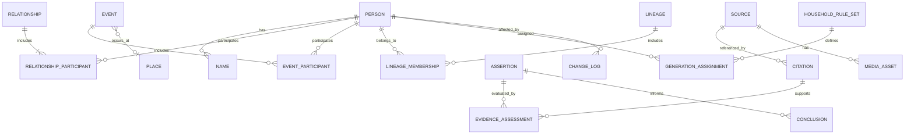

# TFD-101 — Mô hình dữ liệu

**Mã tài liệu:** TFD-101  
**Tên bộ quy chuẩn:** Family Tree Doctrine (TFD)  
**Phiên bản:** 0.1 — Dự thảo để thẩm định  
**Ngày phát hành dự thảo:** 20/10/2026  
**Trạng thái:** Dự thảo; chưa được phê duyệt hoặc ban hành chính thức  
**Tài liệu phụ thuộc:** TFD-001 — Tổng quan và nguyên tắc quy chuẩn

---

## Kiểm soát tài liệu

| Thuộc tính | Giá trị |
|---|---|
| Mục đích | Định nghĩa mô hình dữ liệu logic và các ràng buộc cơ bản cho phần mềm gia phả |
| Đối tượng sử dụng | Kiến trúc sư dữ liệu, kỹ sư phần mềm, nhà nghiên cứu gia phả, quản trị viên dữ liệu |
| Phạm vi triển khai | Độc lập hệ quản trị cơ sở dữ liệu; ưu tiên mô hình quan hệ có thể biểu diễn dưới dạng đồ thị |
| Tính tương thích | Thiết kế để ánh xạ sang GEDCOM; phải khai báo rõ phần mở rộng |
| Trạng thái | Dự thảo 0.1 |

## 1. Mục tiêu thiết kế

Mô hình TFD-101 phải:
- Tách cá nhân khỏi tên, quan hệ, sự kiện, nguồn và kết luận.
- Hỗ trợ nhiều cách ghi và nhiều giả thuyết mà không nhân bản tùy tiện hồ sơ cá nhân.
- Lưu nguồn và chứng cứ gắn với mệnh đề cụ thể.
- Hỗ trợ đặc thù gia phả Việt Nam mà không làm sai lệch dữ liệu GEDCOM.
- Cho phép dựng nhiều loại sơ đồ từ cùng một tập dữ liệu.
- Bảo đảm lịch sử thay đổi, khả năng truy nguyên và quyền riêng tư.
- Có thể triển khai trên cơ sở dữ liệu quan hệ; không phụ thuộc bắt buộc vào cơ sở dữ liệu đồ thị.

## 2. Quy ước thuật ngữ trong đặc tả

- **PHẢI:** yêu cầu bắt buộc để tuyên bố tuân thủ.
- **NÊN:** khuyến nghị mạnh; nếu không áp dụng cần ghi lý do.
- **CÓ THỂ:** lựa chọn được phép.
- **Mã định danh (ID):** định danh duy nhất, ổn định, không mang ngữ nghĩa nghiệp vụ.
- **NULL:** không có giá trị được ghi nhận; không được tự động diễn giải là “không tồn tại”.
- **Mệnh đề (Assertion):** một phát biểu về người, quan hệ, sự kiện, tên hoặc địa điểm.
- **Bản ghi nguyên văn:** dữ liệu được ghi lại theo nguồn.
- **Dữ liệu chuẩn hóa:** biểu diễn hỗ trợ tìm kiếm/tra cứu, không thay thế nguyên bản.

## 3. Kiến trúc logic

Các nhóm thực thể chính:

1. **Identity:** `Person`, `Name`, `PersonIdentifier`.
2. **Relationship:** `Relationship`, `RelationshipParticipant`, `FamilyGroup` (nếu cần cho ánh xạ hoặc nghiệp vụ).
3. **Event & Place:** `Event`, `EventParticipant`, `Place`, `PlaceName`.
4. **Source & Evidence:** `Source`, `SourceRepository`, `Citation`, `Assertion`, `EvidenceAssessment`, `Conclusion`.
5. **Genealogy-specific:** `Lineage`, `LineageMembership`, `GenerationAssignment`, `HouseholdRuleSet`.
6. **Media & Transcription:** `MediaAsset`, `Transcription`, `Translation`.
7. **Governance:** `Agent`, `ChangeLog`, `AccessPolicy`, `ImportExportJob`.

Các thực thể này là mô hình logic TFD. Tên trường và cách ánh xạ vật lý có thể khác theo hệ quản trị cơ sở dữ liệu, miễn là giữ ngữ nghĩa và các ràng buộc bắt buộc.

## 4. Sơ đồ quan hệ khái quát



Sơ đồ khái quát không thay thế mô tả trường và ràng buộc ở các mục tiếp theo. Trong triển khai vật lý, liên kết nguồn với mệnh đề cần hỗ trợ nhiều kiểu chủ thể; có thể dùng bảng liên kết có kiểu hoặc các bảng liên kết chuyên biệt.

## 5. Từ điển dữ liệu

### 5.1. PERSON — Cá nhân

| Trường | Kiểu logic | Bắt buộc | Mô tả |
|---|---|---:|---|
| `person_id` | UUID/ULID hoặc ID ổn định | Có | Khóa chính, không suy ra từ tên |
| `preferred_name_id` | ID tham chiếu | Không | Tên ưu tiên để hiển thị |
| `record_status` | Enum | Có | `active`, `merged`, `deprecated`, `restricted` hoặc trạng thái được quản trị phê duyệt |
| `living_status` | Enum | Không | `living`, `deceased`, `unknown`; phải có nguồn hoặc trạng thái xác định |
| `privacy_level` | Enum | Có | Mức hiển thị theo chính sách dự án |
| `created_at` | DateTime có múi giờ | Có | Thời điểm tạo |
| `created_by` | ID Agent | Có | Người/hệ thống tạo |
| `updated_at` | DateTime có múi giờ | Có | Thời điểm cập nhật |
| `updated_by` | ID Agent | Có | Người/hệ thống cập nhật |
| `notes` | Text | Không | Ghi chú không thay thế trường có cấu trúc |

**Ràng buộc:**
- `person_id` không đổi khi sửa tên, ngày sinh hoặc vị trí trong cây.
- Không lưu một trường `father_name` hoặc `mother_name` làm nguồn dữ liệu duy nhất; quan hệ phải được lưu trong `Relationship`.
- Việc hợp nhất hai hồ sơ phải có nhật ký và tham chiếu định danh cũ.
- Không tạo hồ sơ cá nhân mới chỉ vì gặp biến thể tên; cần quy trình phân giải danh tính.

### 5.2. NAME — Tên và danh xưng

| Trường | Kiểu logic | Bắt buộc | Mô tả |
|---|---|---:|---|
| `name_id` | ID ổn định | Có | Khóa chính |
| `person_id` | ID tham chiếu | Có | Chủ thể |
| `name_type` | Enum mở rộng | Có | Ví dụ `birth`, `courtesy`, `art`, `posthumous`, `clan`, `alias`, `unknown` |
| `name_original` | Unicode Text | Có nếu có tên | Cách ghi theo nguồn hoặc do người cung cấp |
| `script` | Code/Text | Không | Ví dụ Latin, Hán, Nôm hoặc chưa xác định |
| `language` | Code/Text | Không | Ngôn ngữ hoặc truyền thống đọc nếu biết |
| `transliteration` | Text | Không | Phiên âm |
| `translation` | Text | Không | Dịch nghĩa, nếu có |
| `normalized_name` | Text | Không | Dạng chuẩn hóa phục vụ tìm kiếm |
| `valid_from` / `valid_to` | Date/DateRange | Không | Thời gian sử dụng nếu biết |
| `source_citation_id` | ID tham chiếu | Không | Nguồn cho cách ghi |
| `certainty_status` | Enum | Có | Trạng thái xác minh |

Một tên không được ép chứa đồng thời nguyên văn, phiên âm và dịch nghĩa trong cùng một chuỗi. Cần giữ dấu nguyên văn và nguồn của tên.

### 5.3. PERSON_IDENTIFIER — Định danh ngoài hệ thống

| Trường | Kiểu | Bắt buộc | Mô tả |
|---|---|---:|---|
| `identifier_id` | ID | Có | Khóa chính |
| `person_id` | ID tham chiếu | Có | Cá nhân |
| `scheme` | Text/Enum | Có | Hệ thống định danh |
| `value` | Text | Có | Giá trị định danh |
| `source_citation_id` | ID tham chiếu | Không | Nguồn |
| `valid_from` / `valid_to` | Date/DateRange | Không | Thời gian hiệu lực |

Không dùng số định danh cá nhân nhạy cảm làm mã công khai hoặc khóa chính. Chỉ lưu khi có mục đích hợp pháp, cần thiết và chính sách truy cập phù hợp.

### 5.4. RELATIONSHIP — Quan hệ

| Trường | Kiểu | Bắt buộc | Mô tả |
|---|---|---:|---|
| `relationship_id` | ID | Có | Khóa chính |
| `relationship_type` | Enum | Có | `parent_child`, `spouse`, `adoptive`, `guardian`, `clan_affiliation`, `other` |
| `relationship_subtype` | Text/Enum | Không | Ví dụ sinh học, pháp lý, xã hội, được ghi trong nguồn |
| `valid_from` / `valid_to` | Date/DateRange | Không | Thời gian hiệu lực nếu có |
| `assertion_status` | Enum | Có | `proposed`, `supported`, `disputed`, `accepted`, `rejected`, `unknown` |
| `source_citation_id` | ID tham chiếu | Không | Nguồn chính; có thể dùng bảng liên kết nhiều nguồn |
| `notes` | Text | Không | Ghi chú |

Các bên tham gia được lưu trong `RelationshipParticipant` để hỗ trợ quan hệ có hai hoặc nhiều vai trò mà không phải tạo nhiều trường cố định.

### 5.5. RELATIONSHIP_PARTICIPANT — Vai trò trong quan hệ

| Trường | Kiểu | Bắt buộc | Mô tả |
|---|---|---:|---|
| `relationship_id` | ID tham chiếu | Có | Quan hệ |
| `person_id` | ID tham chiếu | Có | Cá nhân |
| `role` | Enum/Text | Có | Ví dụ `parent`, `child`, `spouse`, `adopting_parent`, `adopted_child`, `guardian` |
| `sequence` | Integer | Không | Thứ tự nếu nghiệp vụ yêu cầu |
| `notes` | Text | Không | Ghi chú |

**Ràng buộc nghiệp vụ:**
- Quan hệ cha mẹ–con phải có vai trò tham gia rõ ràng.
- Không cho phép một quan hệ cha mẹ–con tạo chu trình trong đồ thị quan hệ được đánh dấu là cha mẹ–con đã chấp nhận.
- Chu trình được phát hiện phải được báo lỗi hoặc đưa vào hàng đợi rà soát, không tự xóa quan hệ.
- Mô hình phải phân biệt quan hệ sinh học với nhận nuôi/pháp lý/xã hội khi dữ liệu cho phép.
- Không bắt buộc giới tính của cá nhân để lưu quan hệ cha/mẹ.

### 5.6. FAMILY_GROUP — Nhóm gia đình (tùy chọn)

| Trường | Kiểu | Bắt buộc | Mô tả |
|---|---|---:|---|
| `family_group_id` | ID | Có | Khóa chính |
| `group_type` | Enum | Có | Hôn nhân, hộ gia đình, nhóm được ghi trong nguồn hoặc loại khác |
| `display_label` | Text | Không | Nhãn hiển thị |
| `source_citation_id` | ID tham chiếu | Không | Nguồn |
| `notes` | Text | Không | Ghi chú |

Không dùng `FamilyGroup` thay thế quan hệ cá nhân nếu việc thay thế làm mất thông tin về thời gian, loại quan hệ hoặc chứng cứ.

### 5.7. EVENT — Sự kiện

| Trường | Kiểu | Bắt buộc | Mô tả |
|---|---|---:|---|
| `event_id` | ID | Có | Khóa chính |
| `event_type` | Enum/Text | Có | Sinh, mất, kết hôn, an táng, di cư, phong tặng, lập gia phả… |
| `date_expression_original` | Text | Không | Cách ghi ngày trong nguồn |
| `calendar_type` | Enum/Text | Không | Âm lịch, dương lịch, niên hiệu, chưa rõ |
| `date_start` / `date_end` | Date | Không | Biên khoảng ngày quy đổi được |
| `date_precision` | Enum | Có | Ngày, tháng, năm, khoảng, xấp xỉ, không rõ |
| `date_certainty` | Enum | Có | Mức chắc chắn |
| `place_id` | ID tham chiếu | Không | Địa điểm |
| `source_citation_id` | ID tham chiếu | Không | Nguồn chính |
| `notes` | Text | Không | Ghi chú |

Sự kiện có thể gắn nhiều người qua `EventParticipant` với vai trò như người được ghi nhận, người tổ chức, người chứng kiến hoặc người liên quan.

### 5.8. EVENT_PARTICIPANT — Người tham gia sự kiện

| Trường | Kiểu | Bắt buộc | Mô tả |
|---|---|---:|---|
| `event_id` | ID tham chiếu | Có | Sự kiện |
| `person_id` | ID tham chiếu | Có | Cá nhân |
| `role` | Text/Enum | Có | Vai trò trong sự kiện |
| `notes` | Text | Không | Ghi chú |

### 5.9. PLACE và PLACE_NAME — Địa điểm và tên địa danh

**PLACE**

| Trường | Kiểu | Bắt buộc | Mô tả |
|---|---|---:|---|
| `place_id` | ID | Có | Khóa chính |
| `place_type` | Enum/Text | Không | Làng, xã, tổng, huyện, tỉnh, nghĩa trang, đền, địa điểm khác |
| `latitude` / `longitude` | Decimal | Không | Tọa độ nếu đáng tin cậy |
| `parent_place_id` | ID tham chiếu | Không | Địa điểm cấp trên |
| `valid_from` / `valid_to` | Date/DateRange | Không | Khoảng thời gian hành chính hoặc lịch sử |
| `certainty_status` | Enum | Có | Trạng thái xác minh |

**PLACE_NAME**

| Trường | Kiểu | Bắt buộc | Mô tả |
|---|---|---:|---|
| `place_name_id` | ID | Có | Khóa chính |
| `place_id` | ID tham chiếu | Có | Địa điểm |
| `name_original` | Text | Có | Tên nguyên văn |
| `name_normalized` | Text | Không | Tên chuẩn hóa |
| `script` / `language` | Text | Không | Chữ viết/ngôn ngữ |
| `valid_from` / `valid_to` | Date/DateRange | Không | Thời kỳ sử dụng |
| `source_citation_id` | ID tham chiếu | Không | Nguồn |

Không được giả định tên làng/xã ở các thời kỳ khác nhau luôn chỉ cùng một địa điểm hiện đại; quan hệ đồng nhất địa điểm phải có căn cứ.

### 5.10. SOURCE — Nguồn tư liệu

| Trường | Kiểu | Bắt buộc | Mô tả |
|---|---|---:|---|
| `source_id` | ID | Có | Khóa chính |
| `source_type` | Enum/Text | Có | Gia phả, bia, sắc phong, hồ sơ, sách, lời kể, ảnh, cơ sở dữ liệu… |
| `title_original` | Text | Không | Nhan đề nguyên văn |
| `creator` | Text | Không | Tác giả/người lập/cơ quan |
| `creation_date_expression` | Text | Không | Niên đại như nguồn ghi |
| `repository_id` | ID tham chiếu | Không | Nơi lưu trữ |
| `shelfmark` | Text | Không | Ký hiệu lưu trữ |
| `source_language` | Text | Không | Ngôn ngữ |
| `source_script` | Text | Không | Chữ viết |
| `source_condition` | Text/Enum | Không | Tình trạng vật lý/nội dung |
| `digital_uri` | URI/Text | Không | Đường dẫn tới bản số hóa nếu có |
| `rights_statement` | Text | Không | Quyền sử dụng |
| `notes` | Text | Không | Ghi chú |

### 5.11. SOURCE_REPOSITORY — Nơi lưu trữ

Lưu tên cơ quan, bộ sưu tập, địa điểm lưu trữ, mã tham chiếu và thông tin truy cập. Không đưa thông tin nhạy cảm về người cung cấp tư liệu vào trường công khai nếu không cần thiết.

### 5.12. CITATION — Trích dẫn nguồn

| Trường | Kiểu | Bắt buộc | Mô tả |
|---|---|---:|---|
| `citation_id` | ID | Có | Khóa chính |
| `source_id` | ID tham chiếu | Có | Nguồn |
| `locator_original` | Text | Không | Trang, tờ, mặt bia, dòng, mục |
| `quote_original` | Text | Không | Trích nguyên văn |
| `transcription` | Text | Không | Bản phiên chép |
| `translation` | Text | Không | Bản dịch |
| `access_date` | Date | Không | Ngày truy cập nguồn số |
| `citation_note` | Text | Không | Ghi chú trích dẫn |

### 5.13. ASSERTION — Mệnh đề

| Trường | Kiểu | Bắt buộc | Mô tả |
|---|---|---:|---|
| `assertion_id` | ID | Có | Khóa chính |
| `subject_type` | Enum | Có | Person, Relationship, Event, Place, Name… |
| `subject_id` | ID tham chiếu | Có | Đối tượng |
| `predicate` | Text/Enum | Có | Thuộc tính hoặc quan hệ được khẳng định |
| `value_type` | Enum | Có | Text, date, person_ref, place_ref, boolean, structured value… |
| `value_json` | JSON/structured | Có | Giá trị mệnh đề |
| `certainty_status` | Enum | Có | Trạng thái theo TFD |
| `asserted_by` | ID Agent | Không | Người ghi nhận |
| `asserted_at` | DateTime | Có | Thời điểm ghi nhận |
| `notes` | Text | Không | Ghi chú |

Triển khai SQL có thể dùng các bảng chuyên biệt thay cho `value_json` để bảo đảm kiểu dữ liệu. Không dùng trường JSON tự do làm lý do bỏ qua kiểm tra toàn vẹn.

### 5.14. EVIDENCE_ASSESSMENT — Đánh giá chứng cứ

| Trường | Kiểu | Bắt buộc | Mô tả |
|---|---|---:|---|
| `assessment_id` | ID | Có | Khóa chính |
| `assertion_id` | ID tham chiếu | Có | Mệnh đề được đánh giá |
| `citation_id` | ID tham chiếu | Có | Trích dẫn làm căn cứ |
| `assessment_type` | Enum | Có | Supports, contradicts, neutral, inconclusive |
| `reasoning` | Text | Có | Lý do đánh giá |
| `assessed_by` | ID Agent | Có | Người đánh giá |
| `assessed_at` | DateTime | Có | Thời điểm |
| `review_status` | Enum | Có | Draft, reviewed, accepted, disputed |

Một nguồn có thể hỗ trợ một mệnh đề và phản bác mệnh đề khác. Đánh giá phải gắn với từng mệnh đề, không gắn nhãn chất lượng chung cho toàn bộ nguồn.

### 5.15. CONCLUSION — Kết luận nghiên cứu

| Trường | Kiểu | Bắt buộc | Mô tả |
|---|---|---:|---|
| `conclusion_id` | ID | Có | Khóa chính |
| `assertion_id` | ID tham chiếu | Có | Mệnh đề/kết luận được xử lý |
| `conclusion_status` | Enum | Có | Proposed, accepted, disputed, rejected, superseded |
| `reasoning_summary` | Text | Có | Tóm tắt lập luận |
| `criteria_version` | Text | Có | Phiên bản tiêu chí đánh giá |
| `approved_by` | ID Agent | Không | Người phê duyệt |
| `approved_at` | DateTime | Không | Thời điểm phê duyệt |
| `supersedes_conclusion_id` | ID tham chiếu | Không | Kết luận bị thay thế |

Kết luận cũ phải được bảo toàn trong lịch sử. `accepted` là trạng thái quản trị theo quy trình dự án, không phải bảo đảm chân lý tuyệt đối.

### 5.16. LINEAGE — Dòng phả hệ hoặc nhánh

| Trường | Kiểu | Bắt buộc | Mô tả |
|---|---|---:|---|
| `lineage_id` | ID | Có | Khóa chính |
| `lineage_name` | Text | Có | Tên nhánh/dòng |
| `lineage_type` | Enum/Text | Có | Dòng chính, chi, nhánh, hệ phân loại khác |
| `parent_lineage_id` | ID tham chiếu | Không | Nhánh cấp trên |
| `root_person_id` | ID tham chiếu | Không | Người được chọn làm gốc trong hệ thống này |
| `rule_set_id` | ID tham chiếu | Không | Bộ quy tắc áp dụng |
| `source_citation_id` | ID tham chiếu | Không | Căn cứ xác lập |
| `valid_from` / `valid_to` | Date/DateRange | Không | Thời kỳ áp dụng |
| `status` | Enum | Có | Proposed, accepted, disputed, retired |

Một người có thể thuộc nhiều `Lineage` theo các quy ước khác nhau. Không được xem `Lineage` là quan hệ huyết thống.

### 5.17. LINEAGE_MEMBERSHIP — Tư cách trong dòng/chi

| Trường | Kiểu | Bắt buộc | Mô tả |
|---|---|---:|---|
| `membership_id` | ID | Có | Khóa chính |
| `lineage_id` | ID tham chiếu | Có | Dòng/chi |
| `person_id` | ID tham chiếu | Có | Cá nhân |
| `membership_type` | Enum/Text | Có | Huyết thống, nhập phả, nhận nuôi, phối ngẫu, tư cách được ghi nhận… |
| `role_label` | Text | Không | Trưởng chi, chi trưởng, người kế tự… nếu có căn cứ |
| `valid_from` / `valid_to` | Date/DateRange | Không | Thời gian |
| `source_citation_id` | ID tham chiếu | Không | Nguồn |
| `status` | Enum | Có | Proposed, accepted, disputed, retired |

### 5.18. HOUSEHOLD_RULE_SET — Bộ quy tắc dòng họ

Lưu quy tắc tính đời, xác định gốc, phân chi, cách xử lý con nuôi/nhập phả, cách hiển thị trưởng/thứ và ngày giỗ. Trường tối thiểu: `rule_set_id`, `name`, `version`, `scope_description`, `rule_document_uri`, `effective_from`, `effective_to`, `approved_by`, `status`.

Quy tắc phải có phạm vi áp dụng. Không dùng một bộ quy tắc toàn cục cho tất cả gia phả nếu có khác biệt truyền thống.

### 5.19. GENERATION_ASSIGNMENT — Gán thế hệ

| Trường | Kiểu | Bắt buộc | Mô tả |
|---|---|---:|---|
| `generation_assignment_id` | ID | Có | Khóa chính |
| `person_id` | ID tham chiếu | Có | Cá nhân |
| `lineage_id` | ID tham chiếu | Có | Dòng/chi áp dụng |
| `generation_label` | Text | Có | Ví dụ đời thứ N hoặc ký hiệu theo gia phả |
| `generation_number` | Integer | Không | Số thứ tự nếu xác định |
| `rule_set_id` | ID tham chiếu | Có | Bộ quy tắc tính đời |
| `source_citation_id` | ID tham chiếu | Không | Nguồn |
| `status` | Enum | Có | Proposed, accepted, disputed |

Không suy ra thế hệ chỉ bằng độ dài đường đi trong đồ thị nếu chưa xác định quy tắc tính đời và quan hệ nào được tính.

### 5.20. MEDIA_ASSET — Tư liệu số

Trường đề xuất: `media_id`, `media_type`, `file_name`, `mime_type`, `checksum`, `storage_uri`, `created_at`, `rights_statement`, `privacy_level`, `source_id`, `transcription_id`, `notes`.

- Tệp gốc nên được giữ nguyên; bản xử lý là phiên bản riêng.
- Dùng checksum để phát hiện thay đổi tệp.
- Không đưa URL có thông tin xác thực hoặc đường dẫn nội bộ nhạy cảm vào bản xuất công khai.

### 5.21. TRANSCRIPTION và TRANSLATION

Lưu bản phiên chép và bản dịch thành các đối tượng riêng: mã định danh, nguồn/ảnh liên quan, ngôn ngữ/chữ viết, người thực hiện, ngày thực hiện, phiên bản, vùng văn bản, ghi chú về chữ không đọc được và trạng thái duyệt. Bản hiệu đính mới không ghi đè bản cũ.

### 5.22. AGENT — Người hoặc hệ thống thực hiện

Lưu `agent_id`, tên hiển thị, loại (người, tổ chức, hệ thống), thông tin vai trò và trạng thái. Thông tin liên hệ riêng tư nên tách khỏi dữ liệu gia phả và được bảo vệ theo chính sách truy cập.

### 5.23. CHANGE_LOG — Nhật ký thay đổi

| Trường | Kiểu | Bắt buộc | Mô tả |
|---|---|---:|---|
| `change_id` | ID | Có | Khóa chính |
| `entity_type` | Text/Enum | Có | Loại thực thể |
| `entity_id` | ID tham chiếu | Có | Đối tượng thay đổi |
| `action` | Enum | Có | Create, update, merge, retire, restore |
| `before_value` / `after_value` | JSON/Text | Không | Bản ghi trước/sau hoặc chênh lệch |
| `changed_by` | ID Agent | Có | Người/hệ thống |
| `changed_at` | DateTime | Có | Thời điểm |
| `reason` | Text | Có | Lý do |
| `approval_ref` | ID/Text | Không | Quyết định phê duyệt |

Nhật ký phải được bảo vệ khỏi sửa đổi trái phép. Không nhất thiết ghi mọi thao tác đọc vào nhật ký dữ liệu, nhưng truy cập nhạy cảm cần chính sách riêng.

### 5.24. IMPORT_EXPORT_JOB — Tác vụ nhập/xuất

Trường đề xuất: `job_id`, `direction`, `format_name`, `format_version`, `started_at`, `completed_at`, `agent_id`, `status`, `records_read`, `records_created`, `records_updated`, `records_skipped`, `loss_report_uri`, `validation_report_uri`.

Mỗi tác vụ nhập/xuất phải có báo cáo lỗi và cảnh báo; không báo thành công toàn phần khi có dữ liệu bị loại bỏ hoặc chuyển đổi mất ngữ nghĩa.

## 6. Ràng buộc toàn vẹn

### 6.1. Ràng buộc định danh

- Tất cả ID chính phải duy nhất.
- Tham chiếu đến thực thể không tồn tại phải bị từ chối hoặc được ghi nhận trong vùng dữ liệu nhập chưa xử lý.
- Hợp nhất cá nhân phải giữ ánh xạ từ ID cũ sang ID còn hiệu lực.
- Không tái sử dụng ID đã nghỉ hưu.

### 6.2. Ràng buộc quan hệ

- Mỗi quan hệ phải có ít nhất hai vai trò tham gia phù hợp với loại quan hệ.
- Quan hệ cha mẹ–con đã chấp nhận không được tạo chu trình.
- Ngày sinh/mất không hợp lý phải tạo cảnh báo, không tự động sửa.
- Quan hệ có thời gian không được coi là cùng tồn tại nếu khoảng thời gian mâu thuẫn, trừ khi có quy tắc hoặc ngoại lệ được ghi rõ.
- Dữ liệu lịch sử bất thường phải được giữ và đánh dấu, không bị loại bỏ tự động.

### 6.3. Ràng buộc nguồn và chứng cứ

- Trích dẫn phải tham chiếu nguồn hợp lệ.
- Đánh giá chứng cứ phải tham chiếu mệnh đề và trích dẫn.
- Kết luận đã duyệt phải có người duyệt, thời điểm và tiêu chí áp dụng.
- Khi nguồn bị thay đổi hoặc rút lại, hệ thống phải giữ lịch sử và cho phép tìm các kết luận chịu ảnh hưởng.

### 6.4. Ràng buộc ngày tháng

- Phân biệt ngày chính xác, tháng/năm, khoảng thời gian, xấp xỉ và ngày nguyên văn chưa phân tích.
- Không lưu ngày không chắc chắn thành một ngày chính xác giả.
- Mọi giá trị quy đổi từ lịch âm/niên hiệu phải lưu phương pháp, giả định và trạng thái xác minh.
- `date_start` phải không lớn hơn `date_end` khi cả hai có ý nghĩa là khoảng thời gian theo cùng quy ước.

## 7. Phân quyền và quyền riêng tư

Các vai trò gợi ý:
- `Viewer`: xem dữ liệu được phép công khai.
- `Contributor`: đề xuất bổ sung và sửa dữ liệu.
- `Editor`: sửa dữ liệu và quản lý nguồn trong phạm vi được giao.
- `Reviewer`: đánh giá chứng cứ và duyệt kết luận.
- `Administrator`: quản lý người dùng, cấu hình và chính sách.
- `Data steward`: quản trị chất lượng, chuẩn hóa và giải quyết trùng lặp.

Một người có thể có nhiều vai trò. Quyền phải được kiểm soát theo cả vai trò và phạm vi dữ liệu. Dữ liệu người còn sống cần chính sách hiển thị riêng; việc có quyền sửa không đồng nghĩa với quyền xuất công khai.

## 8. Ánh xạ sang GEDCOM

TFD phải duy trì bảng ánh xạ chính thức cho phiên bản GEDCOM được hỗ trợ. Nguyên tắc tổng quát:

| TFD | GEDCOM (khái quát) | Lưu ý |
|---|---|---|
| `Person` | Individual record | ID TFD có thể cần lưu trong trường định danh/extension |
| `Name` | Name structures | Một số loại tên/danh xưng có thể cần extension |
| `Relationship` cha mẹ–con | Family/individual links | Phải giữ đúng vai trò và loại quan hệ |
| `Relationship` hôn nhân | Family record và sự kiện liên quan | Cần ánh xạ theo ngữ nghĩa của phiên bản |
| `Event` | Individual/family event structures | Trường mở rộng có thể cần cho sự kiện đặc thù |
| `Place` | Place structures hoặc trường địa điểm | Lịch sử địa danh có thể cần extension |
| `Source` | Source record | Cần giữ mã lưu trữ và thông tin mô tả |
| `Citation` | Source citation | Mức chi tiết có thể khác giữa các mô hình |
| `MediaAsset` | Multimedia record/link | Phải xử lý đường dẫn và quyền truy cập an toàn |
| `Lineage`, `GenerationAssignment` | Không có ánh xạ chuẩn đầy đủ cho mọi quy tắc địa phương | Cần extension hoặc báo cáo mất mát |

Bảng này là ánh xạ khái quát, không phải tuyên bố tương thích hoàn toàn. TFD phải có tài liệu ánh xạ chi tiết theo từng phiên bản GEDCOM.

## 9. Đề xuất lược đồ SQL khởi đầu

Ví dụ dưới đây minh họa khóa và bảng cốt lõi. Đây không phải DDL sản xuất đầy đủ; kiểu UUID, JSON, ràng buộc và cú pháp cần điều chỉnh theo hệ quản trị cơ sở dữ liệu được chọn.

```sql
CREATE TABLE person (
  person_id UUID PRIMARY KEY,
  record_status VARCHAR(24) NOT NULL,
  living_status VARCHAR(16),
  privacy_level VARCHAR(24) NOT NULL,
  created_at TIMESTAMP NOT NULL,
  created_by UUID NOT NULL,
  updated_at TIMESTAMP NOT NULL,
  updated_by UUID NOT NULL
);

CREATE TABLE person_name (
  name_id UUID PRIMARY KEY,
  person_id UUID NOT NULL REFERENCES person(person_id),
  name_type VARCHAR(32) NOT NULL,
  name_original TEXT NOT NULL,
  script VARCHAR(32),
  language VARCHAR(32),
  transliteration TEXT,
  translation TEXT,
  normalized_name TEXT,
  certainty_status VARCHAR(24) NOT NULL
);

CREATE TABLE relationship (
  relationship_id UUID PRIMARY KEY,
  relationship_type VARCHAR(32) NOT NULL,
  relationship_subtype VARCHAR(32),
  assertion_status VARCHAR(24) NOT NULL,
  valid_from DATE,
  valid_to DATE,
  notes TEXT,
  CHECK (valid_to IS NULL OR valid_from IS NULL OR valid_to >= valid_from)
);

CREATE TABLE relationship_participant (
  relationship_id UUID NOT NULL REFERENCES relationship(relationship_id),
  person_id UUID NOT NULL REFERENCES person(person_id),
  role VARCHAR(32) NOT NULL,
  sequence_no INTEGER,
  PRIMARY KEY (relationship_id, person_id, role)
);

CREATE TABLE source (
  source_id UUID PRIMARY KEY,
  source_type VARCHAR(32) NOT NULL,
  title_original TEXT,
  creator TEXT,
  creation_date_expression TEXT,
  shelfmark TEXT,
  source_language VARCHAR(64),
  source_script VARCHAR(64),
  digital_uri TEXT,
  rights_statement TEXT
);

CREATE TABLE citation (
  citation_id UUID PRIMARY KEY,
  source_id UUID NOT NULL REFERENCES source(source_id),
  locator_original TEXT,
  quote_original TEXT,
  transcription TEXT,
  translation TEXT,
  access_date DATE,
  citation_note TEXT
);

CREATE TABLE assertion (
  assertion_id UUID PRIMARY KEY,
  subject_type VARCHAR(32) NOT NULL,
  subject_id UUID NOT NULL,
  predicate VARCHAR(64) NOT NULL,
  value_type VARCHAR(32) NOT NULL,
  value_json JSON,
  certainty_status VARCHAR(24) NOT NULL,
  asserted_at TIMESTAMP NOT NULL,
  notes TEXT
);

CREATE TABLE evidence_assessment (
  assessment_id UUID PRIMARY KEY,
  assertion_id UUID NOT NULL REFERENCES assertion(assertion_id),
  citation_id UUID NOT NULL REFERENCES citation(citation_id),
  assessment_type VARCHAR(24) NOT NULL,
  reasoning TEXT NOT NULL,
  assessed_at TIMESTAMP NOT NULL,
  review_status VARCHAR(24) NOT NULL
);
```

**Lưu ý triển khai:** `assertion.subject_id` là tham chiếu đa hình nên không thể được bảo vệ bằng một khóa ngoại đơn giản trong ví dụ này. Hệ thống sản xuất nên dùng bảng mệnh đề chuyên biệt hoặc bảng chủ thể chung để bảo đảm toàn vẹn tham chiếu. Cần bổ sung bảng `Agent`, `ChangeLog`, `Event`, `Place`, `Lineage`, `GenerationAssignment`, phân quyền, kiểm tra chu trình và chính sách xóa/ẩn dữ liệu.

## 10. Quy tắc API và định dạng trao đổi

API nếu được xây dựng nên:
- Dùng ID ổn định và biểu diễn quan hệ bằng ID tham chiếu, không nhúng bản sao dữ liệu cá nhân lặp lại không kiểm soát.
- Có phiên bản API và cơ chế tương thích.
- Hỗ trợ phân trang, lọc, tìm kiếm, kiểm soát quyền và nhật ký thay đổi.
- Phân biệt lỗi xác thực, lỗi toàn vẹn, lỗi quyền và cảnh báo mất mát chuyển đổi.
- Có thao tác hợp nhất cá nhân được kiểm soát, không cho xóa tùy tiện các hồ sơ đã tham chiếu.
- Hỗ trợ xuất một phần dữ liệu theo quyền và ghi lại bộ lọc đã áp dụng.

Định dạng trao đổi cần quy định:
- Mã hóa Unicode.
- Quy tắc ID và tham chiếu.
- Cách biểu diễn ngày đầy đủ/không đầy đủ.
- Cách đóng gói ảnh, văn bản phiên chép và tệp đính kèm.
- Cách khai báo extension.
- Báo cáo dữ liệu không chuyển đổi và hướng xử lý.

## 11. Kiểm thử tuân thủ TFD-101

### TC-001 — Trùng tên

Hai người cùng họ tên nhưng có nguồn và quan hệ khác nhau phải có thể tồn tại thành hai hồ sơ riêng. Không tự hợp nhất.

### TC-002 — Nhiều tên

Một cá nhân có tên nguyên văn Hán/Nôm, phiên âm Hán Việt và tên hiệu. Hệ thống phải lưu được từng loại riêng, giữ nguồn và không ghi đè nguyên bản.

### TC-003 — Quan hệ tranh chấp

Hai nguồn đưa ra hai thông tin khác nhau về cha của một người. Hệ thống phải lưu được hai mệnh đề, gắn nguồn, đánh giá và trạng thái tranh chấp.

### TC-004 — Ngày âm lịch

Một nguồn ghi ngày mất theo âm lịch. Hệ thống phải giữ nguyên cách ghi, loại lịch và không tự gán ngày dương lịch nếu chưa đủ dữ kiện.

### TC-005 — Chu trình cha–con

Khi nhập quan hệ tạo chu trình cha–con đã chấp nhận, hệ thống phải chặn hoặc đánh dấu lỗi nghiêm trọng để rà soát, không âm thầm bỏ quan hệ.

### TC-006 — Phân chi

Một cá nhân xuất hiện trong hai cách phân chi ở hai bản phả. Hệ thống phải hỗ trợ hai tư cách có nguồn và trạng thái riêng mà không bắt buộc tạo hai hồ sơ cá nhân.

### TC-007 — Nhập/xuất GEDCOM

Xuất rồi nhập lại dữ liệu mẫu phải giữ được các trường chuẩn trong phạm vi được hỗ trợ. Phần mở rộng không thể biểu diễn phải xuất hiện trong báo cáo mất mát.

### TC-008 — Quyền riêng tư

Người dùng không có quyền không được xem hoặc xuất dữ liệu riêng tư của người còn sống.

### TC-009 — Lịch sử thay đổi

Khi sửa ngày sinh hoặc hợp nhất hai hồ sơ, hệ thống phải lưu người sửa, thời điểm, giá trị trước/sau và lý do.

### TC-010 — Địa danh lịch sử

Tên địa danh cổ và tên hiện đại phải được lưu riêng; thay đổi tên hiện đại không được làm thay đổi bản ghi nguyên văn.

## 12. Các quyết định kỹ thuật còn mở

1. Hệ quản trị cơ sở dữ liệu triển khai (ví dụ PostgreSQL hoặc giải pháp khác).
2. Chuẩn ID vật lý (UUIDv7, ULID hoặc lựa chọn tương đương).
3. Lưu trữ ảnh/tệp trong cơ sở dữ liệu hay object storage.
4. Chiến lược quản lý phiên bản và nhật ký bất biến.
5. Có dùng bảng chủ thể chung hay các bảng mệnh đề chuyên biệt.
6. Bộ mã loại tên, quan hệ, sự kiện và trạng thái chính thức.
7. Chiến lược ngày âm lịch, niên hiệu và khoảng thời gian lịch sử.
8. Phiên bản GEDCOM tối thiểu và chính sách extension.
9. Cơ chế tìm kiếm chữ Hán/Nôm, biến thể chính tả và phiên âm.
10. Chính sách đồng bộ nhiều người biên tập và xử lý xung đột.

## Phụ lục A — Quy tắc đặt tên

- Tên bảng và trường vật lý nên nhất quán, ưu tiên chữ thường và `snake_case`.
- Mã định danh phải trung lập, không mang ý nghĩa nghiệp vụ.
- Trường nguyên văn có hậu tố hoặc tên rõ nghĩa như `*_original`.
- Trường chuẩn hóa dùng `*_normalized`.
- Trường ngày dạng nguyên văn và ngày phân tích phải tách riêng.
- Enum cần có tài liệu mô tả và quy tắc mở rộng; không tự thêm giá trị không kiểm soát.

## Phụ lục B — Tài liệu tham khảo

- GEDCOM 7: https://gedcom.io/specifications/FamilySearchGEDCOMv7.html
- GEDCOM specifications: https://gedcom.io/specs/
- GEDCOM X: https://developers.familysearch.org/main/docs/gedcom-x
- Genealogy Standards: https://www.bcgcertification.org/ethics-standards

Các tài liệu tham khảo giúp định hướng thiết kế, không phải chứng nhận cho mô hình TFD.

## Phụ lục C — Tuyên bố trạng thái

TFD-101 là dự thảo mô hình dữ liệu đề xuất. Trước khi triển khai sản xuất cần chọn hệ quản trị cơ sở dữ liệu, hoàn thiện DDL, định nghĩa enum, chiến lược ngày lịch sử, kiểm soát truy cập, ánh xạ GEDCOM chi tiết và kiểm thử với dữ liệu gia phả thật. Không được coi tài liệu này là tiêu chuẩn đã được cơ quan tiêu chuẩn hóa hoặc tổ chức độc lập phê duyệt.
